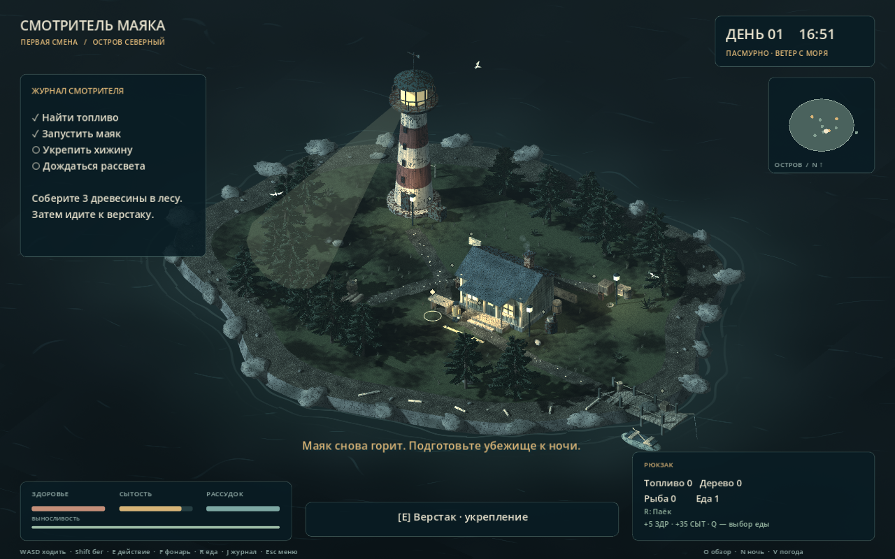
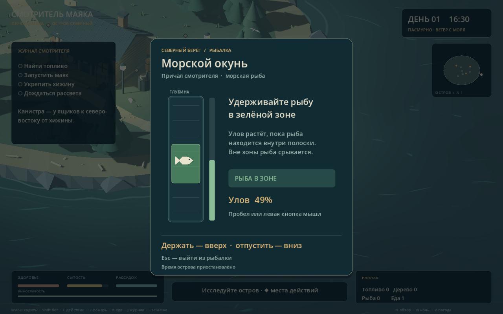
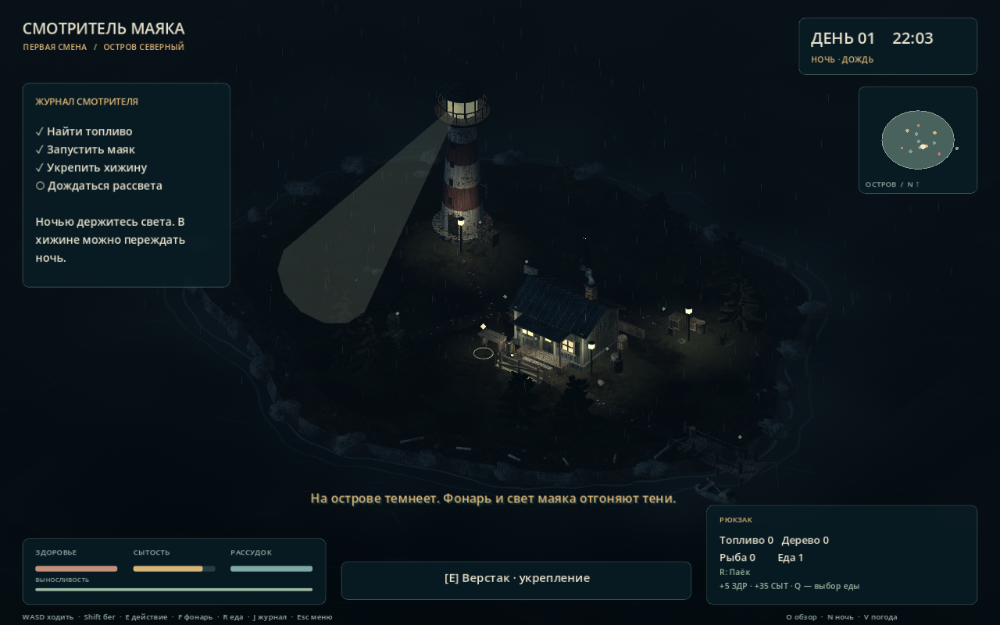

# Смотритель маяка · Первая смена

Атмосферная одиночная survival horror игра для ПК на **Godot 4.7.2**. Учебный проект по курсу «Платформы виртуальной реальности»; сама игра работает без VR.

## Что можно показать уже сейчас

В репозитории находится играбельная первая смена: остров, смотритель в жёлтой куртке, морская атмосфера, вращающийся свет маяка, дневное и ночное освещение, интерфейс и задания.

Окружение переработано в сторону более натуралистичного хоррора. Конусные кроны заменены ветвями с отдельными хвойными побегами; кусты — папоротниковыми листьями, треугольные пучки травы — изогнутыми стеблями. Скалы имеют более сложную округлую неровную форму. Материалы дерева, штукатурки, камня, ткани, почвы и металла создают волокна, трещины, сколы, сырость и ржавчину. Это процедурная графика, без внешних фотосканов. Дневной свет поднят отдельно от ночного, а интерфейс не затрагивается цветокоррекцией.

tools/upgrade_visuals.gd обновляет существующие сцены, сохраняя игровые узлы, положения объектов и точки взаимодействия. Перед таким обновлением сохраните копию сцен. Генератор build_world.gd также применяет scripts/visual_overhaul.gd перед сохранением.

Окружение дополнено ветвистыми соснами с движением листвы, кустарниками, цветами, снастями, запасами и инструментами. Над островом летают чайки, лодка качается на воде, вдоль берега движется прибой. Ночью начинается дождь и появляется тихий тревожный звуковой фон.

Оформление настроено под хоррор: пасмурный дневной свет, приглушённая палитра, холодные тени, тёмное море и более плотный ночной туман. Тёплые окна и фонари помогают ориентироваться. Экранная цветокоррекция, мягкая виньетка и слабое плёночное зерно обрабатывают мир до отрисовки интерфейса, поэтому текст и шкалы остаются читаемыми.

- Найти канистру и запустить генератор маяка.
- Собрать древесину и построить укрепление возле хижины.
- Поймать рыбу, приготовить еду и восстановить сытость.
- Встретить ночные тени: они преследуют смотрителя, наносят урон и отступают от света.
- Переждать подготовленную ночь в хижине и завершить смену на рассвете.
- Сохранить и загрузить смену.
- Принять странный сигнал по радио, прочитать надпись на тропе и собирать находки в личном журнале.

Это демонстрационный фрагмент будущей игры. Цикл на 30 дней, расширенное строительство и сюжетная кампания остаются следующими этапами.

## Рыбалка на причале

У причала нажмите **E** и дождитесь надписи **«Клюёт!»**. Нажмите **Пробел** или **левую кнопку мыши**, чтобы подсечь. Затем удерживайте эту кнопку, чтобы поднимать зелёную полоску, и отпускайте, чтобы опускать её. Рыба должна оставаться внутри полоски: тогда шкала улова растёт. При заполнении шкалы в рюкзак добавляется одна рыба; если шкала опустеет или поклёвка будет пропущена, улова не будет.

Первый улов — обычный морской окунь. После него шанс обычной рыбы — 70%, редкой скумбрии — 25%, легендарного северного осетра — 5%. Более редкая рыба быстрее меняет положение и требует дольше удерживать её в меньшей зоне ловли.

Каждая рыба хранится отдельно: вид, редкость и вес сохраняются после готовки и загрузки игры. На печи **E** готовит выбранную рыбу, **T** выбирает другую. Готовое блюдо автоматически выбирается для еды; **R** съедает его, **Q** переключает готовые блюда. В рюкзаке показаны название, вес, редкость и бонусы выбранной еды.

Здоровье от приготовленной рыбы: базовый бонус редкости (3 / 8 / 18) плюс 0,008 за каждый грамм. Сытость: базовый бонус (12 / 22 / 36) плюс 0,015 за грамм. Результат округляется до целого, показатели героя ограничены 100.

| Пример блюда | Здоровье | Сытость |
| --- | --- | --- |
| Обычный окунь 500 г | +7 | +20 |
| Редкая скумбрия 1000 г | +16 | +37 |
| Легендарный осётр 3000 г | +42 | +81 |

Стартовый паёк по-прежнему восстанавливает 5 здоровья и 35 сытости. Из старых сохранений рыба переносится как обычный окунь 300 г, а готовая еда — как пайки. Проход с причала на остров выровнен по высоте; ящик и бочка сдвинуты к краю настила.

**Esc** отменяет попытку или закрывает результат. Пока открыта рыбалка, время острова, расход сытости и противники приостановлены. Сохраняться можно после выхода из мини-игры; старые сохранения совместимы.

## Запуск

1. Установите обычную версию [Godot 4.7.2 Stable](https://godotengine.org/download/archive/4.7.2-stable/) для своей системы. Вариант .NET не нужен.
2. Скачайте **Code → Download ZIP** и распакуйте архив либо клонируйте репозиторий.
3. В менеджере проектов Godot нажмите **Import**, выберите **project.godot** и откройте проект.
4. Нажмите **F5**, затем **«Начать смену»**.

Для работы выбран рендерер **Compatibility**. Уровень сохранён в scenes/world.tscn и виден в редакторе; главная сцена scenes/main.tscn объединяет уровень, персонажа и камеру.

## Управление

| Клавиша | Действие |
| --- | --- |
| WASD | Ходить относительно камеры |
| Shift | Бежать; расходуется выносливость |
| E | Взаимодействовать с ближайшей точкой ◆ |
| F | Включить или выключить ручной фонарь |
| R | Съесть порцию еды |
| Q | Выбрать готовое блюдо для еды |
| T | Выбрать рыбу для готовки на печи |
| J | Открыть журнал сюжетных находок |
| E / Esc | Закрыть открытую запись |
| ← / → | Листать найденные записи |
| Колесо мыши | Приблизить / отдалить камеру |
| O | Переключить общий обзор острова |
| N | Переключить день / ночь для демонстрации |
| V | Погода: автоматически → дождь → без дождя |
| F9 / F10 | Сохранить / загрузить смену |
| Esc | Пауза и меню |

Сохранение находится в пользовательской папке Godot (user://first_shift_save.json), отдельно от исходников.

## Маршрут первой смены

1. Ящики на северо-восточной тропе → **E** возле канистры.
2. Генератор рядом с маяком → **E** для запуска.
3. Валежник на лесной тропе → собрать **3 древесины**.
4. Верстак слева от входа в хижину → **E**, появится укрепление.
5. По желанию: причал → рыбалка; печь справа от хижины → готовка; **R** → поесть.
6. Дождаться ночи или нажать **N**. Свет маяка, фонарь и укреплённая хижина защищают от теней.
7. Возле входа в подготовленную хижину нажать **E**, чтобы переждать остаток ночи до рассвета.

Для знакомства с историей осмотрите табличку на тропе к маяку и радио на столе у западной стены хижины. Записи можно перечитать через J; во время чтения смена стоит на паузе. Найденные записи и выбранная погода сохраняются вместе со сменой, старые сохранения первой версии остаются совместимыми.

[Сценарий показа преподавателю и описание работы с движком](docs/DEMO_GUIDE.md).

## Как устроен проект

| Файл | Назначение |
| --- | --- |
| scenes/main.tscn | Главная сцена |
| scenes/world.tscn | Редактируемый остров: геометрия, свет, дым, коллизии, Area3D |
| scenes/keeper.tscn | Персонаж, физическая капсула, фонарь и AnimationPlayer |
| scenes/shadow.tscn | Ночной противник |
| scripts/main.gd | Задания, время, выживание, сохранения |
| scripts/player.gd | CharacterBody3D, бег и управление анимацией |
| scripts/shadow.gd | Преследование, отступление от света, обход препятствий |
| scripts/hud.gd / island_map.gd | Меню, журнал, показатели и мини-карта |
| scripts/beacon.gd | Поворот луча и SpotLight3D |
| scripts/soundscape.gd | Синтезированный прибой, шаги и звук взаимодействия |
| scripts/coastal_life.gd | Чайки, качка лодки, дождь, ночные частицы и мерцание фонарей |
| scripts/fishing.gd | Поклёвка, подсечка, физика полоски, поведение рыб и результат улова |
| scripts/fishing_ui.gd | Интерфейс рыбалки и подсказки управления |
| scripts/provisions.gd | Редкость, вес, пищевая ценность и перенос старых сохранений |
| scripts/geometry.gd | Вспомогательные модели из примитивов и треугольников |
| shaders/ocean.gdshader | Движение воды, блики и изменение цвета ночью |
| shaders/foliage.gdshader | Движение ветвей и кустарников на ветру |
| shaders/screen_atmosphere.gdshader | Мягкое затемнение краёв кадра и визуальная реакция на потерю рассудка |
| tools/build_world.gd | Генератор исходной геометрии сохранённых сцен |
| tests/first_shift_test.gd | Интеграционная проверка игрового цикла |

## Проверка и сборка сцен

В терминале с установленным Godot:

    godot --headless --path . --script res://tests/first_shift_test.gd

Набор проверяет игровой цикл, физическое управление, противников, сохранения, журнал и смену погоды — 32 проверки.

Отдельные наборы проверяют рыбалку (33 проверки, включая управление мышью, отмену, сохранения и поведение на 30/60/144 FPS) и безопасное появление героя (6 проверок):

    godot --headless --path . --script res://tests/fishing_test.gd
    godot --headless --path . --script res://tests/spawn_safety_test.gd

Питание и перенос сохранений проверяет tests/provisions_test.gd (21 проверка), проход по причалу в обе стороны — tests/dock_access_test.gd (10 проверок). Всего 102 проверки.

    godot --headless --path . --script res://tests/provisions_test.gd
    godot --headless --path . --script res://tests/dock_access_test.gd

Генератор запускается отдельно и заново записывает world.tscn, keeper.tscn и shadow.tscn. Для обычного запуска игры он не нужен:

    godot --headless --path . --script res://tools/build_world.gd

Если меняете эти сцены вручную в редакторе, сохраните изменения в Git перед повторной генерацией.

## Команда и учебные материалы

- Влад Людкевич — [Vlad1k22](https://github.com/Vlad1k22).
- Костя Котельников.
- Андрей Виговский.
- Артём Артамонов.

Учебные материалы:

- [Презентация концепции и первого результата в Godot — 18 слайдов](docs/presentation/Смотритель_маяка_прогресс_Godot.pptx).
- [Рассказ о разработке и памятка для показа преподавателю](docs/speech/Смотритель_маяка_рассказ_о_разработке.docx).
- В этих документах сохранён этап первой демоверсии; последние изменения графики и рыбалки показаны скриншотами и описаны в этом README.
- Предыдущие варианты презентации и выступления оставлены в тех же папках.

В assets/portraits/ лежат портреты команды, в assets/concept/ — концепт острова, в docs/references/ — референсы. [Что изменилось](CHANGELOG.md), [источники](docs/CREDITS.md), [дизайн-документ](docs/GAME_DESIGN.md), [совместная работа](CONTRIBUTING.md).

Репозиторий публичный. Для изменения кода напрямую участник должен принять персональное приглашение владельца.
