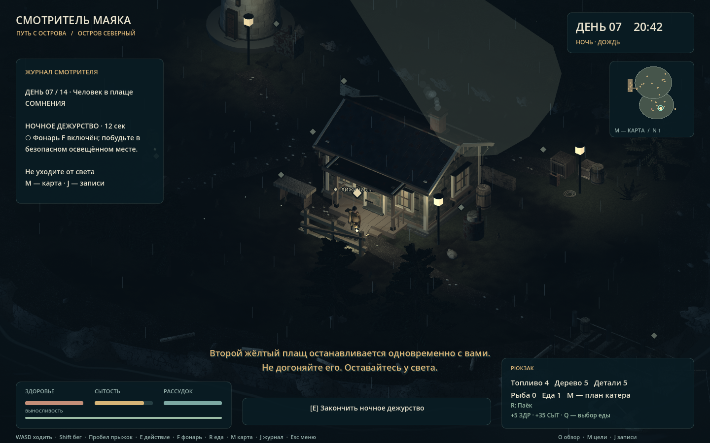
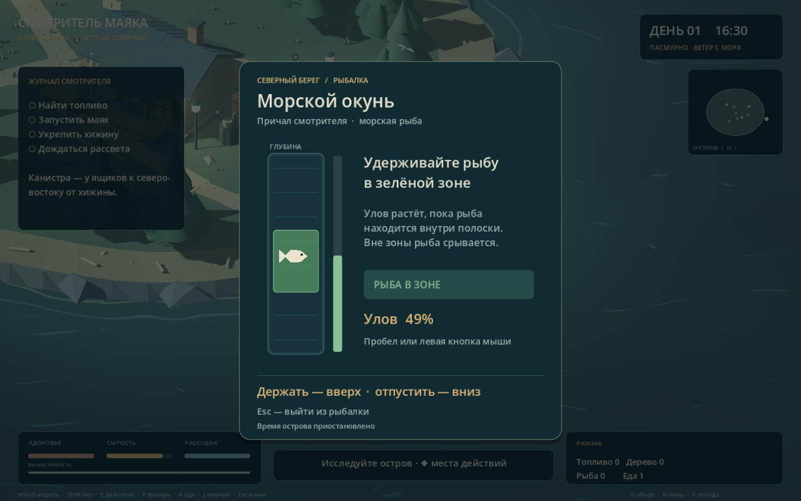
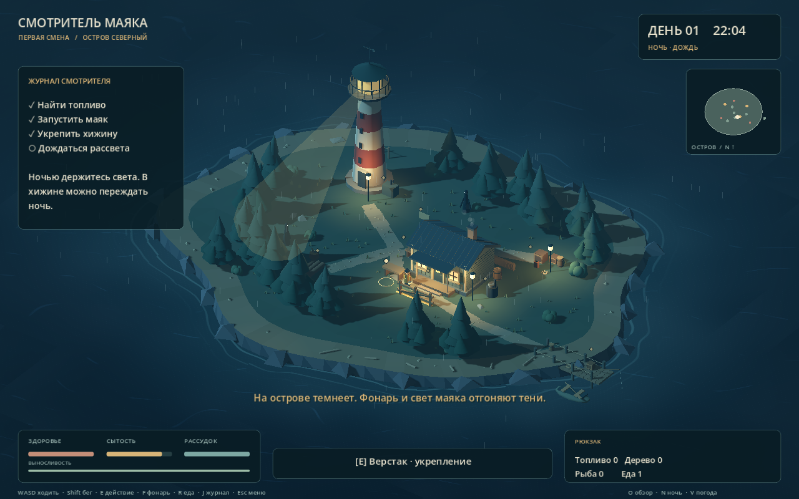

# Смотритель маяка · Путь с острова

Атмосферная одиночная survival horror игра для ПК на **Godot 4.7.2**. Учебный проект по курсу «Платформы виртуальной реальности»; сама игра работает без VR.

**Новая игра рассчитана на 14 дней и 13 ночей.** Готовьте маяк и хижину, ремонтируйте катер, соберите три цифры и выходите в море утром 14-го дня. Сумма сценарных таймеров — 14:07. Старые сохранения продолжаются по своему 30-дневному календарю. [Как играть](docs/campaign/README.md) · [План всех 14 дней](docs/campaign/ALL_14_DAYS.md).

**Blender → MCP → Godot:** в игру подключены [маяк](docs/art/lighthouse/README.md), [катер «Северный»](docs/art/coastal_vessel/README.md), [хижина смотрителя](docs/art/keeper_cabin/README.md) и [радиостанция с антенной и передатчиком](docs/art/radio_station/README.md). На маяке линза загорается вместе с вращающимся лучом. На радиостанции после ремонта появляются аккумулятор и зелёный индикатор связи.

[Персонажи](docs/art/characters/README.md) тоже собраны в Blender: смотритель с фонарём в руке, высокая Тень и тяжёлый Утопленник. У них 23 анимации. Смотритель может коротко прыгать, а враги предупреждают движением перед ударом.

В [маяк](docs/art/lighthouse/README.md#игровой-интерьер) можно войти на **E** и пешком подняться по винтовой лестнице к линзе. Камера приближается и показывает башню в разрезе.

В [хижине, радиостанции, рубке катера и на старом складе](docs/art/interiors/README.md) также доступны интерьеры. В хижине можно готовить, слушать радио и начинать дежурство у койки. На катер ведёт трап, дверь рубки находится на левом борту.

## Что можно показать уже сейчас

Первые четыре дня знакомят с островом и связью. Затем ремонт катера идёт вместе с поиском улик. Последние два дня отведены под передачу кода, последнее дежурство и отплытие. Ночные сцены длятся от 12 до 20 секунд, а задачи ночи могут занять дольше.

Кнопка **«Начать смену»** запускает кампанию. **«Демо · Первая смена»** открывает отдельный эпизод со вступлением, подсказками и разговором по радио. **«Свободный осмотр · гавань»** открывает площадку для осмотра моделей и механик. **M** показывает карту и следующую цель, **J** — записи.

**Настройки** доступны в меню и на паузе. Они сохраняют размер окна, полноэкранный режим, качество сглаживания и теней, громкость окружения, речи и музыки. В хижине можно завести граммофон клавишей **E**. Журнал экипажа спрятан в каюте «Северного».

[Настройки](docs/screenshots/game-settings.png) · [Граммофон](docs/screenshots/cabin-gramophone.png) · [Финальный экран](docs/screenshots/game-ending.png).

Новая северная часть соединена с исходным островом: склад с инструментами, деталями и аптечкой, колодец с ремонтируемым насосом, радиостанция, остов лодки с аккумулятором, гавань, топливные бочки, тайник, ловушка и костёр. Добавлено **17 точек взаимодействия**; всего их 26.

Катер «Северный» имеет проходимую палубу и трап. Для выхода нужны ремонт корпуса (5 дерева и 2 детали), двигатель (4 детали), 3 канистры топлива, 3 готовых блюда и работающий передатчик. В новой кампании также нужны код связи на 13-й день и последнее дежурство. Утром 14-го дня можно подойти к штурвалу и отплыть.

[Показ свободного осмотра гавани и моделей](docs/DEMO_2026_10_27.md). [Кампания на 14 дней](docs/campaign/README.md).

Окружение переработано в сторону более натуралистичного хоррора. Конусные кроны заменены ветвями с отдельными хвойными побегами; кусты — папоротниковыми листьями, треугольные пучки травы — изогнутыми стеблями. Скалы имеют более сложную округлую неровную форму. Материалы дерева, штукатурки, камня, ткани, почвы и металла создают волокна, трещины, сколы, сырость и ржавчину. Это процедурная графика, без внешних фотосканов. Дневной свет поднят отдельно от ночного, а интерфейс не затрагивается цветокоррекцией.

tools/upgrade_visuals.gd обновляет существующие сцены, сохраняя игровые узлы, положения объектов и точки взаимодействия. Перед таким обновлением сохраните копию сцен. Генератор build_world.gd также применяет scripts/visual_overhaul.gd перед сохранением.

Окружение дополнено ветвистыми соснами с движением листвы, кустарниками, цветами, снастями, запасами и инструментами. Над островом летают чайки, лодка качается на воде, вдоль берега движется прибой. Ночью начинается дождь и появляется тихий тревожный звуковой фон.

Оформление настроено под хоррор: пасмурный дневной свет, приглушённая палитра, холодные тени, тёмное море и более плотный ночной туман. Тёплые окна и фонари помогают ориентироваться. Экранная цветокоррекция, мягкая виньетка и слабое плёночное зерно обрабатывают мир до отрисовки интерфейса, поэтому текст и шкалы остаются читаемыми.

- Найти канистру и запустить генератор маяка.
- Собрать древесину и построить укрепление возле хижины.
- Поймать рыбу, приготовить еду и восстановить сытость.
- Встретить ночные тени: они преследуют смотрителя, наносят урон и отступают от света.
- Переждать ночь в подготовленной хижине и открыть следующий игровой день.
- Каждый день добывать детали, древесину и топливо; снова заправлять маяк.
- Ремонтировать насос, передатчик, корпус и двигатель катера.
- Ставить ловушку с наживкой; забирать улов на следующий день.
- Использовать аптечку, воду и костёр в гавани.
- Подготовить катер и выйти к спасателям утром 14-го дня.
- Сохранить и загрузить смену.
- Принять странный сигнал по радио, прочитать надпись на тропе и собирать находки в личном журнале.

Ночные события включают стук, ложные передачи, наблюдающую фигуру, двойника, осаду света, штормы и отключения питания.

| День | Новая цель |
| --- | --- |
| 1 | Найти топливо, запустить генератор, осмотреть линзу, укрепить хижину и встретить рассвет у койки |
| 2 | Забрать инструменты и детали на северном складе |
| 3 | Отремонтировать насос колодца |
| 4 | Найти аккумулятор в остове лодки и восстановить передатчик |
| 5–6 | Записать первую цифру, отремонтировать корпус и двигатель, открыть аварийный запас |
| 7–8 | Найти свои следы и вторую цифру, вернуть свет после отключения |
| 9–10 | Приготовить улов, найти записку у аптечки, зажечь резервный огонь |
| 11–12 | Найти третью цифру, проверить курс и погрузить провизию |
| 13 | Передать код, нанести маршрут и пройти последнее дежурство |
| 14 | Заправить катер, проверить припасы и отплыть |

Топливная бочка даёт 2 канистры в день, склад — 2 детали, северный валежник — 2 дерева. Одной канистры генератору хватает на три ночи; утром достаточно снова включить его. На рассвете валежник возобновляется, костёр гаснет. Ночлег снимает 8 сытости, восстанавливает 5 здоровья и переводит время на 07:00. Часть сюжетных находок содержит реальные припасы, поэтому ежедневного сбора всех ресурсов не требуется.

## Рыбалка на причале

У причала нажмите **E** и дождитесь надписи **«Клюёт!»**. Нажмите **Пробел** или **левую кнопку мыши**, чтобы подсечь. Затем удерживайте эту кнопку, чтобы поднимать зелёную полоску, и отпускайте, чтобы опускать её. Рыба должна оставаться внутри полоски: тогда шкала улова растёт. При заполнении шкалы в рюкзак добавляется одна рыба; если шкала опустеет или поклёвка будет пропущена, улова не будет.

Первый улов — обычный морской окунь. После него шанс обычной рыбы — 70%, редкой скумбрии — 25%, легендарного северного осетра — 5%. Более редкая рыба быстрее меняет положение и требует дольше удерживать её в меньшей зоне ловли.

Каждая рыба хранится отдельно: вид, редкость и вес сохраняются после готовки и загрузки игры. На печи **E** готовит выбранную рыбу, **T** выбирает другую. Готовое блюдо автоматически выбирается для еды; **R** съедает его, **Q** переключает готовые блюда. В рюкзаке показаны название, вес, редкость и бонусы выбранной еды.

Здоровье от приготовленной рыбы: базовый бонус редкости (3 / 8 / 18) плюс 0,008 за каждый грамм. Сытость: базовый бонус (12 / 22 / 36) плюс 0,015 за грамм. Результат округляется до целого, показатели героя ограничены 100.

| Пример блюда | Здоровье | Сытость |
| --- | --- | --- |
| Обычный окунь 500 г | +7 | +20 |
| Редкая скумбрия 1000 г | +16 | +37 |
| Легендарный осётр 3000 г | +42 | +81 |

Стартовый паёк по-прежнему восстанавливает 5 здоровья и 35 сытости. Из старых сохранений рыба переносится как обычный окунь 300 г, а готовая еда — как пайки. Проход с причала на остров выровнен по высоте; ящик и бочка сдвинуты к краю настила.

**Esc** отменяет попытку или закрывает результат. Пока открыта рыбалка, время острова, расход сытости и противники приостановлены. Сохраняться можно после выхода из мини-игры; старые сохранения совместимы.

## Рюкзак, сбор ресурсов и выживание

**B** открывает материалы, улов, еду и снаряжение. Выбранную рыбу можно приготовить прямо из рюкзака рядом с печью или использовать у пустой ловушки. Готовое блюдо можно съесть сразу или назначить на **R**. На вкладке снаряжения можно включить фонарь, выпить воду и наполнить флягу у исправного насоса. **B** или **Esc** закрывает рюкзак.

На старом складе **E** выдаёт обычные две детали. С 2-го дня **G** у запасов открывает аккуратный разбор. Нажмите **Пробел** трижды, стараясь попадать в зелёную зону. Два точных нажатия дают одну дополнительную деталь, три — две. Разбор использует тот же дневной запас, что и обычный сбор. Зона сужается на 5-й и 10-й дни.

У валежника **G** открывает выбор сухого полена и даёт шанс получить дополнительную древесину. У топливных бочек в гавани **G** запускает насос. Удерживайте **Пробел**, чтобы поднять давление, и отпускайте, чтобы оставаться в зелёной зоне. Обычный сбор доступен на **E**.

С 3-го дня у починенного насоса можно наполнить флягу на **H**. Вдали от насоса **H** расходует одну порцию, чтобы восстановить выносливость и рассудок. У печи **K** открывает рецепты. Для ухи нужны рыба и вода, для копчёной рыбы — рыба и древесина. Ровный жар улучшает блюдо, а уха также согревает. Копчёную рыбу первой грузят на катер. Одно полено можно потратить на обогрев хижины. Ночью и под дождём герой мёрзнет, а на поздних сменах холод сильнее замедляет восстановление выносливости.

## Радиоприёмник

У домашнего радио и работающего передатчика **U** открывает поиск частоты. **← / →** двигают шкалу, **E** прослушивает выбранную частоту. Кроме берегового канала есть две передачи с подсказками для журнала. В 11-ю и 13-ю ночи у домашнего радио нужно подтвердить и позывной, и контрольную отметку из журнала **J**.

## Запуск

Готовая Windows-сборка и архив игровых моделей Blender доступны в [последнем релизе](https://github.com/Vlad1k22/lighthouse-keeper/releases/latest). Для защиты используйте [путеводитель с маршрутом показа и полным прохождением](docs/speech/Путеводитель_Смотритель_маяка.docx).

Для самостоятельной Windows-сборки в Godot доступен профиль **Windows Desktop**. Он помещает игру и её ресурсы в один файл `build/Windows/LighthouseKeeper.exe`. Для повторного экспорта нужны шаблоны той же версии Godot.

1. Установите обычную версию [Godot 4.7.2 Stable](https://godotengine.org/download/archive/4.7.2-stable/) для своей системы. Вариант .NET не нужен.
2. Скачайте **Code → Download ZIP** и распакуйте архив либо клонируйте репозиторий.
3. В менеджере проектов Godot нажмите **Import**, выберите **project.godot** и откройте проект.
4. Нажмите **F5**, затем **«Начать смену»**.

Для работы выбран рендерер **Compatibility**. Уровень сохранён в scenes/world.tscn и виден в редакторе; главная сцена scenes/main.tscn объединяет уровень, персонажа и камеру.

## Управление

| Клавиша | Действие |
| --- | --- |
| WASD | Ходить относительно камеры |
| Shift | Бежать; расходуется выносливость |
| Пробел | Прыгнуть с земли; 18 выносливости. Во время рыбалки управляет удочкой |
| E | Взаимодействовать с ближайшей точкой ◆ |
| B | Открыть рюкзак |
| G | Аккуратный разбор, поиск сухого полена или удержание давления |
| H | Наполнить флягу у рабочего насоса, в других местах — выпить |
| K | Открыть рецепты и обогрев у печи |
| U | Настроить радиочастоту у приёмника |
| F | Включить или выключить ручной фонарь |
| R | Съесть порцию еды |
| Q | Выбрать готовое блюдо для еды |
| T | Выбрать рыбу для готовки на печи |
| J | Открыть журнал сюжетных находок |
| M | Карта острова, план дня, ресурсы и готовность катера |
| E / Esc | Закрыть открытую запись |
| ← / → | Листать найденные записи |
| Колесо мыши | Приблизить / отдалить камеру |
| O | Переключить общий обзор острова |
| N | Переключить день / ночь только в свободном осмотре |
| V | Погода: автоматически → дождь → без дождя |
| F9 / F10 | Сохранить / загрузить смену |
| Esc | Пауза и меню |

Сохранение находится в пользовательской папке Godot (user://first_shift_save.json), отдельно от исходников.

## Маршрут первой смены

1. Ящики на северо-восточной тропе → **E** возле канистры.
2. Генератор рядом с маяком → **E** для запуска.
3. Валежник на лесной тропе → собрать **3 древесины**.
4. Верстак слева от входа в хижину → **E**, появится укрепление.
5. По желанию: причал → рыбалка; печь справа от хижины → готовка; **R** → поесть.
6. Проверить задачи и фонарь. Возле входа в подготовленную хижину нажать **E**, чтобы приблизить ночь.
7. Пережить короткую ночную сцену, следуя подсказке. Ещё раз **E** у двери — следующий день.

Для знакомства с историей осмотрите табличку на тропе к маяку и радио на столе у западной стены хижины. Записи можно перечитать через J; во время чтения смена стоит на паузе. Найденные записи и выбранная погода сохраняются вместе со сменой, старые сохранения первой версии остаются совместимыми.

[Актуальное сюжетное прохождение](docs/campaign/README.md). [Свободный осмотр для преподавателя](docs/DEMO_2026_10_27.md). [Архив первой смены](docs/DEMO_GUIDE.md).

## Как устроен проект

| Файл | Назначение |
| --- | --- |
| scenes/main.tscn | Главная сцена |
| scenes/world.tscn | Редактируемый остров: геометрия, свет, дым, коллизии, Area3D |
| scenes/northern_coast.tscn | Северная часть, склад, радиостанция, гавань и катер; видны в редакторе |
| scenes/keeper.tscn | Персонаж, физическая капсула, фонарь и AnimationPlayer |
| scenes/shadow.tscn | Ночной противник |
| scripts/main.gd | Задания, время, выживание, сохранения |
| scripts/campaign_days.gd | Цели, награды и ночные сцены текущего и архивного календарей |
| scripts/campaign.gd | Подготовка, события, контрольная группа и переходы кампании |
| scripts/expedition.gd | Календарь, новые взаимодействия, состояние катера, карта и отплытие |
| scripts/player.gd | CharacterBody3D, бег и управление анимацией |
| scripts/shadow.gd | Преследование, отступление от света, обход препятствий |
| scripts/hud.gd / island_map.gd | Меню, журнал, показатели и мини-карта |
| scripts/beacon.gd | Поворот луча и SpotLight3D |
| scripts/soundscape.gd | Синтезированный прибой, шаги и звук взаимодействия |
| scripts/coastal_life.gd | Чайки, качка лодки, дождь, ночные частицы и мерцание фонарей |
| scripts/fishing.gd | Поклёвка, подсечка, физика полоски, поведение рыб и результат улова |
| scripts/fishing_ui.gd | Интерфейс рыбалки и подсказки управления |
| scripts/provisions.gd | Редкость, вес, пищевая ценность и перенос старых сохранений |
| scripts/geometry.gd | Вспомогательные модели из примитивов и треугольников |
| shaders/ocean.gdshader | Движение воды, блики и изменение цвета ночью |
| shaders/foliage.gdshader | Движение ветвей и кустарников на ветру |
| shaders/screen_atmosphere.gdshader | Мягкое затемнение краёв кадра и визуальная реакция на потерю рассудка |
| tools/build_world.gd | Генератор исходной геометрии сохранённых сцен |
| tools/build_expansion.gd | Отдельный генератор северной части и катера |
| tests/first_shift_test.gd | Интеграционная проверка игрового цикла |

## Проверка и сборка сцен

В терминале с установленным Godot:

    godot --headless --path . --script res://tests/first_shift_test.gd

Набор проверяет игровой цикл, физическое управление, противников, сохранения, журнал и смену погоды — 32 проверки.

Отдельные наборы проверяют рыбалку (33 проверки, включая управление мышью, отмену, сохранения и поведение на 30/60/144 FPS) и безопасное появление героя (6 проверок):

    godot --headless --path . --script res://tests/fishing_test.gd
    godot --headless --path . --script res://tests/spawn_safety_test.gd

Питание и перенос сохранений проверяет tests/provisions_test.gd (21 проверка), проход по причалу в обе стороны — tests/dock_access_test.gd (10 проверок).

tests/expedition_test.gd сохраняет 65 регрессионных проверок экономики и взаимодействий свободного осмотра; tests/northern_access_test.gd — 14 проверок реальной ходьбы через северный перешеек, склад, трап и палубу.

    godot --headless --path . --script res://tests/expedition_test.gd
    godot --headless --path . --script res://tests/northern_access_test.gd

Отдельные наборы проверяют модели, интерьеры, персонажей и первую ночь. `tests/campaign_test.gd` проверяет 14-дневную кампанию до отплытия. С аргументом `-- --legacy-calendar` он прогоняет исходный календарь. [Результаты](docs/campaign/verification.json).

    godot --headless --path . --script res://tests/ship_asset_test.gd

Все наборы в PowerShell:

    ./tools/run_tests.ps1 -Godot "C:/путь/к/Godot_console.exe"

    godot --headless --path . --script res://tests/provisions_test.gd
    godot --headless --path . --script res://tests/dock_access_test.gd

Генератор запускается отдельно и заново записывает world.tscn, keeper.tscn и shadow.tscn. Для обычного запуска игры он не нужен:

    godot --headless --path . --script res://tools/build_world.gd

Если меняете эти сцены вручную в редакторе, сохраните изменения в Git перед повторной генерацией.

Северная часть генерируется отдельно и не перезаписывает исходный остров:

    godot --headless --path . --script res://tools/build_expansion.gd

Сохранение версии 4 содержит ремонты, припасы, сюжетные задачи, ночной таймер, отключения питания, записи и контрольную точку начала дня. Форматы 1–3 читаются; прошлые дни засчитываются, необходимые старые фрагменты кода попадают в архив журнала. Ручной слот — user://first_shift_save.json, автосохранение дня — user://campaign_day_checkpoint.json. Старое имя приложения сохранено, чтобы не менять пользовательскую папку Godot.

## Команда и учебные материалы

- Влад Людкевич — [Vlad1k22](https://github.com/Vlad1k22).
- Костя Котельников.
- Андрей Виговский.
- Артём Артамонов.

Учебные материалы:

- [Арт-лист острова и список моделей для Blender](docs/art/ART_LIST.md): существующие объекты, четыре предложения для новых мест, приоритеты и требования к замене моделей.
- [Актуальная презентация — 28 слайдов, обновления на слайдах 19–28](docs/presentation/Смотритель_маяка_прогресс_26_10_2026.pptx).
- [Текст выступления к новым слайдам и маршрут показа в Godot](docs/speech/Текст_выступления_обновления_игры.docx).
- [Презентация концепции и первого результата в Godot — 18 слайдов](docs/presentation/Смотритель_маяка_прогресс_Godot.pptx).
- [Рассказ о разработке и памятка для показа преподавателю](docs/speech/Смотритель_маяка_рассказ_о_разработке.docx).
- В PowerPoint и Word сохранён этап первой демоверсии. Новая северная часть, катер и календарь описаны в актуальной памятке и показаны скриншотами этого README.
- Предыдущие варианты презентации и выступления оставлены в тех же папках.

В assets/portraits/ лежат портреты команды, в assets/concept/ — концепт острова, в docs/references/ — референсы. [Что изменилось](CHANGELOG.md), [источники](docs/CREDITS.md), [дизайн-документ](docs/GAME_DESIGN.md), [совместная работа](CONTRIBUTING.md).

Репозиторий публичный. Для изменения кода напрямую участник должен принять персональное приглашение владельца.
