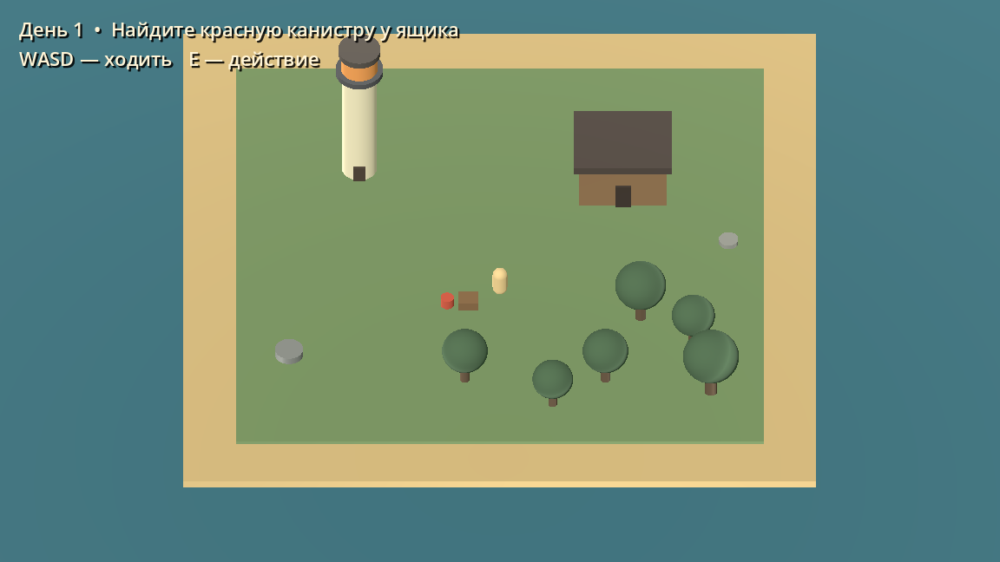

# Смотритель маяка

Учебный проект по курсу **«Платформы виртуальной реальности»**. Мы делаем обычную игру для ПК на **Godot 4**, без VR: объёмный вид сверху под углом, выживание на небольшом острове и постепенно усиливающаяся атмосфера хоррора.

## Идея игры

Игрок — смотритель маяка. Планируемая цель — прожить на острове 30 игровых дней: поддерживать работу маяка, искать ресурсы, ловить рыбу, готовить еду и обустраивать убежище. Днём нужно выполнять поручения и готовиться к ночи; ночью появляются опасные существа.

История будет оставлять сомнения: действительно ли на острове есть монстры или герой постепенно теряет связь с реальностью из-за одиночества и рутины? Подсказки в окружении, звуке и цветах помогут раскрывать эту тему.

Это задумка будущей игры. Сейчас в репозитории находится **первый технический прототип**.

## Что уже работает

- Небольшой остров с пляжем, маяком, хижиной, деревьями и камнями.
- Перемещение персонажа и столкновения с землёй и зданиями.
- Ортографическая камера, которая следует за персонажем.
- Задание: подобрать топливо у красной канистры и включить маяк.
- Подсказка текущего задания на экране.

Пока окружение и персонаж собраны из простых 3D-фигур. Инвентарь, голод, рыбалка, строительство, враги, смена суток, сохранения и сюжетные события ещё предстоит сделать.

## Как запустить

1. Скачайте обычную Windows-версию [Godot Engine](https://godotengine.org/download/windows/). Рекомендуемая для этого проекта версия — **4.7.2 Stable**. Вариант .NET не нужен: код написан на GDScript.
2. Скачайте репозиторий: **Code → Download ZIP** и распакуйте архив. Для совместной разработки лучше клонировать его через Git или GitHub Desktop.
3. Запустите Godot. В менеджере проектов нажмите **Import**, выберите `project.godot` из корня этой папки и затем **Import & Edit**.
4. Нажмите **F5** или кнопку запуска проекта ▶.

Сцена острова создаётся кодом в `scripts/main.gd` при запуске. Поэтому в редакторе до запуска вы увидите корневой узел сцены, а само окружение — в окне игры.

### Управление и первое задание

| Клавиша | Действие |
| --- | --- |
| W / A / S / D | Ходить |
| E | Взаимодействовать с объектом рядом |

Подойдите к красной канистре возле ящика и нажмите **E**. Затем подойдите к основанию маяка и снова нажмите **E**. В прототипе пока нет отдельного инвентаря: перенос топлива хранится как состояние задания. Чтобы остановить игру, закройте её окно или нажмите **F8** в редакторе.

## Что лежит в репозитории

| Путь | Содержимое |
| --- | --- |
| `project.godot` | Файл проекта для импорта в Godot |
| `scenes/main.tscn` | Главная сцена |
| `scripts/main.gd` | Создание острова, камеры, интерфейса и первого задания |
| `scripts/player.gd` | Управление персонажем |
| `assets/portraits/` | Все подготовленные портреты команды и описание их стиля |
| `assets/concept/` | Концепт острова |
| `docs/presentation/` | Редактируемая презентация PowerPoint |
| `docs/speech/` | Текст выступления в Word на 3–4 минуты |
| `docs/references/` | Визуальные референсы и ссылки на исходные изображения |
| `docs/screenshots/` | Скриншот прототипа |
| `docs/GAME_DESIGN.md` | Концепция и следующий этап разработки |

Материалы: [презентация](docs/presentation/Смотритель_маяка.pptx), [текст выступления](docs/speech/Смотритель_маяка_выступление_3–4_минуты.docx), [описание источников](docs/CREDITS.md).

## Команда

- Влад Людкевич — [Vlad1k22](https://github.com/Vlad1k22).
- Костя Котельников.
- Андрей Виговский.
- Артём Артамонов.

Роли на слайде команды — предварительные; распределение задач можно менять по мере освоения движка.

## Как работать вместе

Порядок работы описан в [CONTRIBUTING.md](CONTRIBUTING.md): получить доступ, клонировать проект, создать ветку, сохранить изменения и открыть Pull Request.

Репозиторий принадлежит личному аккаунту Влада. После персонального приглашения участники смогут менять код, отправлять коммиты, создавать и объединять Pull Request и работать с задачами. Доступ к настройкам и управлению участниками остаётся у владельца — так устроены личные репозитории GitHub.

## Ближайшая цель

Довести один игровой день до законченного короткого цикла: получить поручение → собрать ресурс → выполнить поручение → подготовиться к ночи → пережить ночь. Подробный список следующей работы — в [дизайн-документе](docs/GAME_DESIGN.md).
