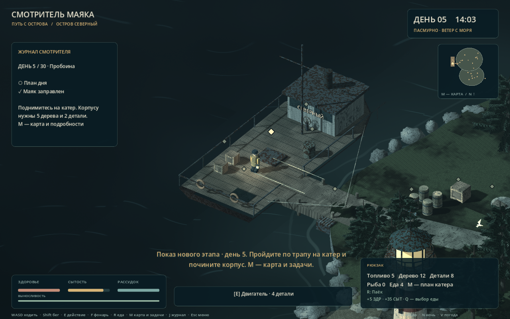
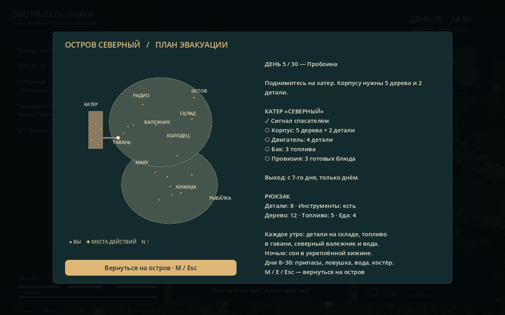

# Показ нового этапа: «Путь с острова»

## Как открыть

Откройте project.godot в Godot, нажмите F5. В главном меню выберите **«Свободный осмотр · гавань»**. Это отдельное демонстрационное начало с пятого дня: инструменты, аккумулятор, насос и передатчик уже восстановлены, в рюкзаке лежат материалы для ремонта. Ваше прежнее сохранение не перезаписывается автоматически. Обычная кнопка «Начать смену» запускает новую [сюжетную кампанию на 30 дней](campaign/README.md) с первого дня.

Если игра запущена отдельно, Esc открывает меню, F8 в редакторе останавливает запуск игры. Для показа редактируемого мира откройте main.tscn или northern_coast.tscn, выберите узел и нажмите F, чтобы приблизить его.

## Маршрут на 4–6 минут

1. **M: карта и план.** Покажите две соединённые части острова, склад, колодец, радиостанцию, остов лодки и гавань. Справа — план дня, запас деталей и готовность катера. M закрывает карту. O показывает весь остров, повторное O возвращает камеру.
2. **Пройдите на палубу по трапу.** E у пробоины на корме чинит корпус: расходуется 5 дерева и 2 детали, появляется деревянная заплата, маркер становится зелёным. E возле бака тратит 3 топлива. К двигателю пока можно подойти, но его ремонт откроется на шестой день.
3. **Вернитесь на берег.** Покажите бочку топлива: E выдаёт 2 канистры, повторное нажатие не даёт бесплатных ресурсов. Можно осмотреть тайник, костёр и ловушку. Для костра нужно одно дерево; его свет создаёт безопасную зону.
4. **Покажите север.** На складе E у центральных ящиков выдаёт 2 детали в день, аптечка лечит раны. У колодца восстановленный насос даёт воду. Радиопередатчик повторяет сообщение спасателей. M поможет найти все места.
5. **Откройте следующий день.** В демонстрационном начале маяк уже горит, хижина укреплена. Нажмите N для ночи, дойдите до входа в хижину на старой части острова и нажмите E. Начнётся шестой день, обновится план; маяк снова потребует топливо.
6. **Почините двигатель.** На катере E у люка расходует 4 детали. Появятся дым и звук работающего мотора. F9 сохраняет ремонты, календарь и запасы; F10 загружает их.

Если есть ещё 1–2 минуты: заправьте маяк у старого генератора, ночью ещё раз переночуйте в хижине — откроется седьмой день. На катере E у грузовых ящиков погрузит 3 блюда. После ремонта корпуса, двигателя, заправки бака, погрузки и радиосвязи E у штурвала запускает отплытие. Выход возможен только днём. Корабль и персонаж действительно движутся, затем показывается финал.

Клавиша N — только ускорение времени для показа; она сама не выполняет задания и не переводит календарь на следующий день. Для перехода используйте ночлег.

## Что рассказать преподавателю

«После первой версии мы расширили сам игровой цикл. Раньше игра заканчивалась на первом рассвете. Теперь у нас есть календарь, первые семь дней с разными работами и ежедневные задачи до тридцатого дня.

Мы добавили новую северную часть острова. На ней находятся склад, колодец, радиостанция и гавань. Каждый объект связан с логикой: детали нужны для ремонта, аккумулятор — для передатчика, топливо — для маяка и катера. Некоторые вещи можно забрать один раз, другие обновляются каждый день.

Главная новая цель — восстановить катер. Игрок ремонтирует корпус и двигатель, заправляет бак и запасает еду. После связи со спасателями можно выйти в море. Работы расходуют реальные предметы из рюкзака, а состояние катера сохраняется.

В Godot северный берег и корабль сделаны отдельной сценой. Модели собраны из мешей, у земли, настила и палубы настроены физические коллизии. Мы проверили переходы, чтобы персонаж не застревал на трапе. Объекты взаимодействия используют Area3D, а календарь и ремонт написаны на GDScript. Карта и задания работают через интерфейс, дым и след катера — через частицы, звук двигателя синтезируется кодом.

Следующий этап — разнообразить события после первой недели, улучшить модели, поведение противников и строительство. Сейчас отплытие — короткая автоматическая сцена; ручное управление кораблём ещё не реализовано».

## Что показать в редакторе

| Файл или узел | Что видно |
| --- | --- |
| scenes/main.tscn → World → NorthernCoast | Новая сцена подключена к прежнему миру |
| scenes/northern_coast.tscn → PeninsulaCollision | Физическая поверхность новой суши |
| CoastalVessel → WalkableDeck → Collision | Физическая палуба катера |
| ShipGangplank → Collision | Проходимый трап на одном уровне с береговым настилом |
| Station_ship_engine / Station_pump | Area3D, радиус действия и маркер |
| CoastalVessel → EngineSmoke / SailingWake | Дым и след катера |
| scripts/expedition.gd | Условия ремонтов, расход ресурсов, календарь и отплытие |
| scripts/island_map.gd | Отрисовка карты и мест взаимодействия |
| scripts/main.gd → save_game / load_game | Сохранение состояния экспедиции |

## Ограничения и проверки

Первые семь дней имеют отдельные цели. Дни 8–30 чередуют четыре повторяемых поручения: древесина, ловушка, вода и костёр. Это ещё не тридцать уникальных сюжетных дней. Катер можно подготовить и покинуть остров с седьмого дня; после тридцатого окно закрывается. Ручного плавания, открытого моря и новой карты материка пока нет.

Пройдены 181 проверка: базовый цикл — 32, рыбалка — 33, питание — 21, старый причал — 10, появление героя — 6, экспедиция — 65, новые проходы — 14. Отдельно проверены обычная ходьба через склад, переход на корабль в обе стороны, доступ к штурвалу, переходы ночи и утра, расход ресурсов и восстановление сохранения.

