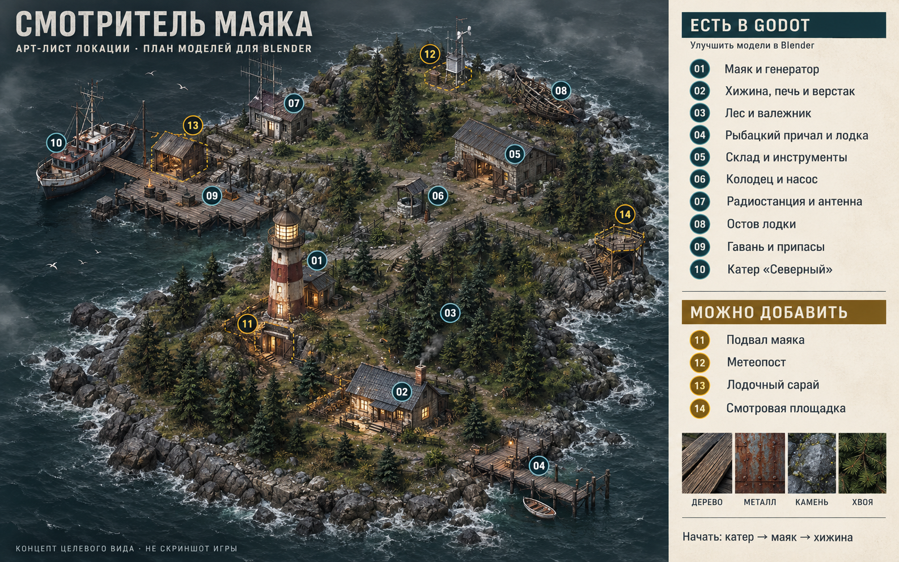

# Смотритель маяка — арт-лист острова

Версия 1 · 26 октября 2026 · план моделей для Blender и размещения в Godot.

Это концепт целевого внешнего вида. Он опирается на нынешнее расположение основных мест, но не является скриншотом игры или точным чертежом рельефа. Расстояния, высоты, размеры и ширину проходов сверяем с рабочей сценой Godot.

**Бирюзовые номера 01–10:** места уже существуют в Godot; их модели можно постепенно заменять. **Жёлтые номера 11–14:** предложения для будущих версий; этих мест и их взаимодействий в игре пока нет.

Основная часть моделей прототипа сделана геометрией Godot. **В Blender через MCP готовы катер «Северный» (A37–A44), внешний вариант хижины (A04) и радиостанция с антенной и передатчиком (A26–A28).** Они экспортированы и установлены в игру. [Катер](coastal_vessel/README.md); [хижина](keeper_cabin/README.md); [радиостанция и ремонт](radio_station/README.md). Для остальных объектов отметка «есть» означает наличие прототипа в Godot.

## Общий внешний вид

- Сырой северный остров: сосны, каменные берега, выгоревшие доски, ржавчина, соляные потёки, мох.
- Реалистичные пропорции и читаемые силуэты при виде сверху под углом.
- Пасмурный день позволяет рассмотреть окружение. Ночью холодный мир освещают тёплые окна, маяк, ручной фонарь и костёр.
- Износ должен объяснять историю объекта: облупившаяся краска у моря, ремонтные заплаты, потемнение около печи. Мелкие детали добавляем после проверки силуэта в игровой камере.
- Основные поверхности: дерево, окрашенный металл, ржавый металл, камень, штукатурка, ткань, стекло. Мокрые поверхности блестят умеренно.

## Места и объекты на карте

| № | Место | Что должно находиться здесь | Что уже работает / что предлагается |
| --- | --- | --- | --- |
| 01 | Маяк и генератор | Башня, дверь, балкон, фонарь маяка, крыша, генератор, кабель, канистра | Есть свет маяка и заправка генератора. Внутренняя лестница и посещаемый интерьер ещё не реализованы |
| 02 | Хижина смотрителя | Дом, крыльцо, окна, печь с котелком, верстак, укрепление, радио, запасы досок | Есть ночлег, готовка, строительство укрепления и сюжетная запись по радио. Вход внутрь дома пока не реализован |
| 03 | Лес и валежник | Сосны нескольких форм, кусты, папоротники, трава, камни, пни, брёвна и топор | Есть сбор валежника. Отдельная механика рубки стоящих деревьев пока не реализована |
| 04 | Рыбацкий причал | Доски, сваи, верёвочные ограждения, удочка, ящик, бочка, маленькая лодка и вёсла | Есть мини-игра рыбалки; лодка рядом — декоративная |
| 05 | Северный склад | Здание с открытым входом, ящики, инструменты, детали, аптечка | Есть получение инструментов, ежедневных деталей и лечение |
| 06 | Колодец | Каменный колодец, навес, насос, бочка; ведро можно добавить | Есть ремонт насоса и ежедневное получение воды |
| 07 | Радиостанция | Техническая будка, антенна, растяжки, передатчик, провода | Есть ремонт передатчика и связь со спасателями |
| 08 | Остов лодки | Сломанный корпус, шпангоуты, обломки, аккумулятор | Есть получение аккумулятора. Новые записки и дополнительные находки — возможное расширение |
| 09 | Старая гавань | Причал, сваи, топливные бочки, канистры, ящики, тайник, ловушка, костёр, указатели | Есть ежедневное топливо, тайник, ловушка с наживкой и защитный костёр |
| 10 | Катер «Северный» | Корпус, палуба, рубка, трап, штурвал, люк двигателя, бак, грузовой ящик, спасательные круги, швартовы | Есть ремонт, заправка, погрузка еды и автоматическое отплытие. Ручного управления пока нет |
| 11 | Подвал маяка | Вход, люк или дверь, ступени, стены, стеллаж, электрощиток, запасные лампы | Новая идея: ремонт электрики, поиск деталей и сюжетных записей |
| 12 | Метеопост | Приборный ящик, мачта, флюгер, анемометр, шкала ветра | Новая идея: узнавать о шторме заранее и ремонтировать приборы |
| 13 | Лодочный сарай | Деревянное строение, двери, стойка для вёсел, сети, снасти, подвесной светильник | Новая идея: хранить наживку и снасти, улучшать ловушку |
| 14 | Смотровая площадка | Настил на скале, безопасное ограждение, скамья, бинокль | Новая идея: замечать сигналы в море и находить сюжетные подсказки |

## Список работ по моделям

**П0** — главные модели, сильнее всего меняющие вид игры. **П1** — следующий проход: предметы, растительность, повторяемые элементы. **П2** — новые места и дополнительные детали после проверки основных моделей.

Пустой флажок относится к новой версии модели в Blender. «Механика есть» относится к существующей игре.

| Blender | Код | Зона | Модель или набор | Сейчас | Что подготовить | Приоритет |
| --- | --- | --- | --- | --- | --- | --- |
| [ ] | A01 | 01 | Башня маяка | Есть | Корпус, дверь, балкон, перила и крыша отдельными частями | П0 |
| [ ] | A02 | 01 | Фонарь маяка | Есть; свет вращается | Остекление, линза и вращаемая часть отдельно; источник света остаётся в Godot | П0 |
| [ ] | A03 | 01 | Генератор | Есть; механика есть | Корпус, мотор, панель, заливная горловина; удобная точка взаимодействия | П0 |
| [x] | A04 | 02 | Хижина | Blender → MCP → Godot; ночлег сохранён | Внешняя обшивка, крыша, дверь, окна, крыльцо, дымоход и сход; посещаемый интерьер — отдельный будущий этап | П0 |
| [ ] | A05 | 02 | Печь и котелок | Есть; готовка есть | Печь, труба, конфорка, кастрюля отдельными объектами | П1 |
| [ ] | A06 | 02 | Верстак | Есть; строительство есть | Столешница, ножки, несколько инструментов; оставить место перед столом | П1 |
| [ ] | A07 | 02 | Укрепление | Есть; строится за дерево | Стойки, доски и раскосы модульными деталями | П1 |
| [ ] | A08 | 02 | Радиоприёмник со столиком | Есть; сюжетная запись есть | Корпус, решётка, ручки настройки и антенна | П1 |
| [ ] | A09 | 02 | Огород и бытовые запасы | Есть как декор | Доски, грядки, тара; механика выращивания пока отдельно не реализована | П2 |
| [ ] | A10 | 03 | Сосны | Есть | Один базовый вид и 2–3 варианта формы; повторять с изменением поворота и размера | П1 |
| [ ] | A11 | 03 | Кусты, папоротник, трава | Есть | Небольшой повторяемый набор, читаемый при игровой камере | П1 |
| [ ] | A12 | 03, берег | Камни и скальные модули | Есть | 4–6 разных камней; сочетать в группы и береговые стенки | П1 |
| [ ] | A13 | 03 | Валежник и брёвна | Есть; сбор работает | Целое бревно, обломок, связка дров и торец | П1 |
| [ ] | A14 | 03 | Пень с топором | Есть как декор | Пень и топор раздельно; будущая рубка требует отдельной логики | П1 |
| [ ] | A15 | 04, 09 | Модуль причала | Есть; проходы проверены | Прямая секция, край, угловая секция, свая, столбик и верёвка | П1 |
| [ ] | A16 | 04 | Маленькая лодка и вёсла | Есть как декор | Корпус, сиденья, вёсла; сохранить точку качания лодки | П1 |
| [ ] | A17 | 04 | Удочка | Есть; рыбалка работает | Удилище и катушка, леску лучше оставить отдельным простым элементом | П1 |
| [ ] | A18 | 04, 09 | Верёвки и швартовы | Есть | Бухта, прямой отрезок, узел; использовать повторно в гавани и на катере | П1 |
| [ ] | A19 | 05 | Здание склада | Есть; можно войти | Стены, крыша, широкая дверная рама; не сузить существующий проход | П1 |
| [ ] | A20 | 05 | Ящик инструментов | Есть; подбирается | Закрытый ящик с ручкой; простая крышка отдельно при необходимости | П1 |
| [ ] | A21 | 05 | Детали и упаковка | Есть в виде ящиков; выдаются ресурсы | Набор ящиков и несколько крупных деталей для обозначения склада | П1 |
| [ ] | A22 | 05 | Аптечный шкаф | Есть; лечит | Корпус, дверца, знак, упаковки перевязочных материалов | П1 |
| [ ] | A23 | 06 | Колодец | Есть | Каменное кольцо, тёмная внутренняя часть, стойки и навес | П1 |
| [ ] | A24 | 06 | Насос | Есть; ремонт и вода работают | Основание, корпус, носик, рычаг отдельно | П0 |
| [ ] | A25 | 06 | Ведро | Новая деталь | Ведро и ручка; самостоятельная механика переноски воды пока не реализована | П2 |
| [x] | A26 | 07 | Радиобудка | Blender → MCP → Godot | Внешний корпус, крыша, дверь, окно, вентиляция и ввод кабеля | П1 |
| [x] | A27 | 07 | Антенна | Blender → MCP → Godot | Решётчатая мачта, лестница, антенны, основание, растяжки и натяжители | П1 |
| [x] | A28 | 07 | Передатчик | Blender → MCP → Godot; ремонт работает | Корпус, шкала, ручки, микрофон, кабели и аккумулятор; два состояния ремонта | П1 |
| [ ] | A29 | 08 | Разбитая лодка | Есть | Шпангоуты, куски обшивки, сломанный борт; без мелкой скрытой геометрии | П1 |
| [ ] | A30 | 08 | Аккумулятор | Есть; подбирается | Корпус, ручка, клеммы и предупреждающая маркировка | П1 |
| [ ] | A31 | 09 | Топливная бочка | Есть; выдаёт топливо | Одна основа с 2–3 вариантами краски и ржавчины | П1 |
| [ ] | A32 | 01, 09 | Канистра | Есть; ресурс топлива есть | Корпус, ручка, крышка; общая модель для разных мест | П1 |
| [ ] | A33 | 05, 09, 10 | Ящики и грузовая тара | Есть; часть объектов интерактивна | Малый и большой ящик, закрытый и открытый варианты; повторять по острову | П1 |
| [ ] | A34 | 09 | Рыболовная ловушка | Есть; наживка и улов работают | Каркас, сетка или решётка, крышка; не строить сложную коллизию по каждой проволоке | П1 |
| [ ] | A35 | 09 | Кострище | Есть; создаёт безопасную зону | Камни и поленья; огонь, свет и частицы остаются в Godot | П1 |
| [ ] | A36 | Весь остров | Таблички и доска задач | Есть; часть содержит записи и карту | Основа таблички, столбик, доска с бумагами; текст удобнее держать отдельно | П1 |
| [x] | A37 | 10 | Корпус и палуба катера | Blender → MCP → Godot | Детализированный корпус и настил; физический проход сохранён | П0 |
| [x] | A38 | 10 | Рубка катера | Blender → MCP → Godot | Полая рубка, окна, дворники, приборы, крыша, труба и мачта | П0 |
| [x] | A39 | 10 | Двигатель и люк | Blender → MCP → Godot | Дизель под решёткой, фильтры, трубки, привод и индикатор готовности | П0 |
| [x] | A40 | 10 | Пробоина и заплата | Blender → MCP → Godot | Раздельные повреждённый и починенный варианты | П0 |
| [x] | A41 | 10 | Бак и грузовой ящик | Blender → MCP → Godot | Детализированные бак, обвязка и грузовые ящики | П1 |
| [x] | A42 | 10 | Штурвал | Blender → MCP → Godot | Колесо со спицами, ручками и стойкой | П1 |
| [x] | A43 | 10 | Трап | Blender → MCP → Godot | Отдельный трап с настилом и ограждениями, убирается при отплытии | П0 |
| [x] | A44 | 10 | Спасательные круги и мелкое оснащение | Blender → MCP → Godot | Круги, кранцы, тумбы, якорь, цепь и бухты верёвки | П1 |
| [ ] | A45 | 11 | Вход в подвал | Новое место | Дверь или люк, каменная рама, небольшая лестница | П2 |
| [ ] | A46 | 11 | Подвал и электрооборудование | Новое место | Модульные стены, пол, потолок, стеллаж, щиток, запасные лампы | П2 |
| [ ] | A47 | 12 | Метеопост | Новое место | Мачта, флюгер, анемометр, приборный шкаф | П2 |
| [ ] | A48 | 13 | Лодочный сарай | Новое место | Стены, двери, крыша, стойка для снастей | П2 |
| [ ] | A49 | 13 | Сети и снасти | Новые детали | Свёрнутая сеть, поплавки, стойка для вёсел; без плотной сетки из отдельных трубок | П2 |
| [ ] | A50 | 14 | Смотровая площадка | Новое место | Настил, опоры, ограждение, скамья; проход достаточно широкий для героя | П2 |
| [ ] | A51 | 14 | Бинокль | Новый предмет | Корпус и стойка либо переносной вариант; наблюдение потребует новой механики | П2 |
| [ ] | A52 | Персонажи | Смотритель | Есть; ходьба и бег работают | Персонаж с отдельной подготовкой скелета и анимаций; начинать после статичных моделей | П1 |
| [ ] | A53 | Персонажи | Ручной фонарь | Есть; свет отгоняет тени | Корпус, стекло, ручка; свет оставить отдельным узлом Godot | П1 |
| [ ] | A54 | Персонажи | Ночная тень | Есть; преследует и атакует | Читаемый силуэт, затем скелет и анимации; сохранить простую физическую форму | П1 |
| [ ] | A55 | Предметы | Три вида рыбы | Виды есть в мини-игре; отдельных подробных 3D-моделей нет | Окунь, скумбрия и осётр как предметы для будущего визуального отображения улова | П2 |
| [ ] | A56 | Предметы | Еда и упаковки припасов | Есть в инвентаре; подробные предметные модели не сделаны | Блюдо с рыбой, сухпаёк, упаковка; расход еды уже работает | П2 |

## С чего начать

1. **Пробный предмет — один ящик или канистра.** Проверить масштаб, внешний вид и замену в существующей сцене, прежде чем делать большой объект.
2. **Катер:** корпус, палуба, рубка, трап. Его уже можно осмотреть в игре, отремонтировать и использовать для финала.
3. **Маяк и генератор:** главный ориентир острова, хорошо видимый издалека.
4. **Хижина, печь и верстак:** место, куда игрок постоянно возвращается.
5. **Насос, передатчик и складские предметы:** улучшить вид ключевых взаимодействий.
6. **Повторяемый набор:** сосны, камни, брёвна, бочки, ящики, верёвки. Повторное использование моделей поможет сделать весь остров единым по стилю.
7. **Новые места 11–14:** добавлять после замены главных моделей и проверки маршрутов.

## Как принимать готовую модель

Это рабочие требования именно для нашего проекта.

- Исходник хранить в Blender, игровой вариант — отдельным файлом .glb. Папки assets/source_blender/ и assets/models/ уже содержат катер, хижину и радиостанцию.
- Предлагаемое имя: A37_ship_hull_v01.blend и A37_ship_hull_v01.glb. Код совпадает со списком выше.
- Масштаб сверять с существующим смотрителем и сценой. Трап, настил и палубу подгонять по реальной высоте, чтобы повторно не появилась проблема прохода с причала.
- Сначала заменять видимую часть объекта. Сохранять существующие игровые узлы, точки взаимодействия и логику, затем подгонять простые коллизии.
- Подвижные части делать отдельно: штурвал, рычаг насоса, дверь, крышка, вращаемая часть фонаря маяка.
- Для ремонта готовить варианты «повреждено» и «починено» с одинаковой точкой привязки.
- Огонь, дым, дождь, свет, звук и игровую логику настраивать в Godot.
- Сначала проверить силуэт, читаемость и размер при нашей игровой камере. Потом добавлять мелкие детали.

Флажки для каждой принятой модели:

- [ ] Исходник Blender сохранён.
- [ ] Игровой вариант помещён в проект.
- [ ] Масштаб и положение проверены.
- [ ] Материалы видны днём и ночью.
- [ ] Сохранена точка взаимодействия.
- [ ] Герой проходит вокруг модели и не застревает.
- [ ] Повреждённый и починенный вид работают, если нужны.
- [ ] Существующее действие E по-прежнему выполняется.

## Материалы листа

- [Картинка в полном размере](lighthouse-location-art-sheet-v1.png).
- [Промпт генерации](generation-prompt-v1.txt).
- Основа расположения: [актуальный скриншот игры](../screenshots/expanded-island.png).
- Изображение создано встроенным image_gen по скриншоту как референсу; готовый файл сохранён в проекте. Это документ планирования, он не заменяет игровые модели.
