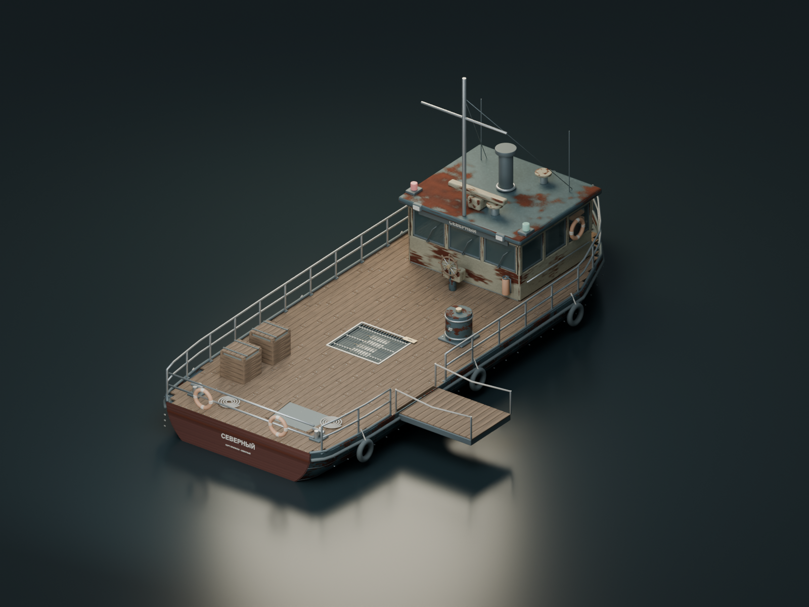
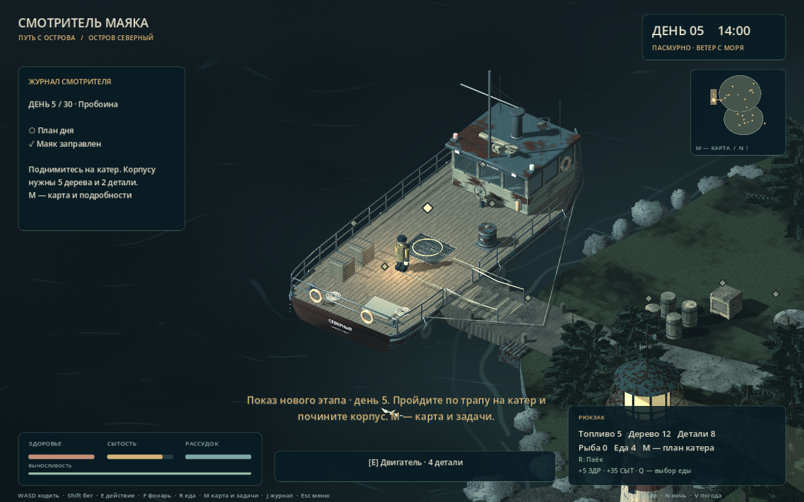

# Первый объект Blender → MCP → Godot: катер «Северный»

Катер создан и отредактирован в **Blender 5.2.2 LTS через настоящий MCP-сервер mcp-for-blender 2.2.4**. Команды передавались стандартным MCP-клиентом по stdio, затем выполнялись Blender-аддоном. Meshy, готовые сторонние модели и генерация 3D по картинке не использовались.

Это один собранный игровой объект. Его части соответствуют пунктам A37–A44 арт-листа.

## Готовые файлы

- [Редактируемый исходник Blender](../../../assets/source_blender/coastal_vessel/A37_coastal_vessel_v01.blend).
- [Игровой экспорт GLB](../../../assets/models/coastal_vessel/coastal_vessel_v01.glb).
- [Скриншот модели в работающей игре](godot-in-game.png).
- [Проверка структуры GLB](glb-inspection.json).
- [Повторное открытие исходника и проверка упакованных текстур](source-roundtrip.json).
- [Характеристики модели](asset-statistics.json).
- [Короткий замер производительности в Godot](godot-profile.json).

## Что сделано

Криволинейный стальной корпус с килем, обшивкой, поясами и заклёпками; деревянная палуба из отдельных досок с крепежом; полая рубка с остеклением, рамами, дверью, дворниками, пультом, приборами и креслом; наружный штурвал; мачта, антенны, радар, навигационные огни, вентиляция и выхлоп.

На палубе находятся двигатель под обслуживаемой решёткой, бак с обвязкой, грузовые ящики, швартовные тумбы, бухты верёвки, якорь с цепью, кранцы, спасательные круги и огнетушитель. Трап сделан отдельной частью. Для ремонта подготовлены отдельные повреждённый и починенный варианты, для двигателя — индикатор готовности.

Текст на корпусе и табличках преобразован в геометрию: игровая модель и видимая надпись в исходнике не требуют установленного системного шрифта.

## Характеристики

| Параметр | Значение |
| --- | --- |
| Исходник | 1 227 отдельных объектов, сохранены для редактирования |
| Игровой экспорт | 10 мешей по сборочным группам, 46 поверхностей |
| Полная детализация | 395 274 треугольника |
| Материалы | 15; обычные PBR-материалы Godot StandardMaterial3D |
| Текстуры | 12 растровых карт: Base Color, Normal, Metallic/Roughness для четырёх поверхностей |
| Окрашенный металл корпуса | 4096 × 4096 |
| Светлая краска рубки, дерево палубы | 2048 × 2048 |
| Нижняя окраска корпуса | 1024 × 1024 |
| Длина корпуса | Около 17,8 м |
| Ширина корпуса | Около 6,8 м, без трапа и выступающего оснащения |
| Высота опорной палубы | 1,0 м — соответствует существующей физике |
| Оси | Blender: Z вверх, нос по +Y. Godot: Y вверх, нос по −Z |
| Формат | glTF 2.0, бинарный GLB; все текстуры внутри |

Это подробная модель главного объекта. Для более слабых устройств можно позднее подготовить дополнительный облегчённый вариант; сейчас Godot автоматически формирует LOD и меши теней при импорте.

## Совместимость с Godot

- GLB самостоятельно содержит геометрию, материалы и изображения, без внешних текстурных URI.
- Для запуска игры Blender не требуется. Папка исходников закрыта от автоматического импорта файлом .gdignore.
- Шейдерные узлы Blender не нужны в игре: подготовлены обычные растровые PBR-карты.
- Карты нормалей и Metallic/Roughness используют соответствующие каналы; прозрачность окон импортируется как BLEND.
- Коллекция презентации с морем, камерой и освещением исключена из экспорта.
- tools/import_ship.gd добавляет mip-уровни и анизотропную фильтрацию. Это подготовка текстур для игровой камеры, геометрия модели при этом не создаётся и не меняется.
- Все текстуры исходника упакованы в .blend; проверено повторное открытие после удаления промежуточных PNG.

## Как модель подключена к игре

В scenes/northern_coast.tscn импортированный GLB находится внутри CoastalVessel → BlenderVisual. scripts/ship_visual.gd подключает видимую модель и синхронизирует варианты ремонта.

Проверенные физические тела палубы, трапа и препятствий сохранены. Старые геометрические оболочки скрыты; их коллизии продолжают работать. Интерактивные точки, расход ресурсов, сохранение и движение катера остались частью Godot.

При ремонте переключаются SV_HullDamage и SV_HullPatch_Repaired. Ремонт двигателя включает SV_EngineReady; дым и звук продолжают работать через прежнюю логику. Перед отплытием визуальный трап убирается.

## Проверки

Новый набор tests/ship_asset_test.gd проверяет импорт PackedScene, состав мешей, PBR-материалы, карты, UV, mipmaps, нормали, размеры и оси, исключение презентационных объектов, сохранение коллизий, ремонт и загрузку состояний. В нём 21 проверка.

Вместе с прежними наборами полный комплект содержит **202 проверки**. Дополнительно выполнен запуск отплытия с настоящей физикой и снят кадр в Godot.

Профиль godot-profile.json — короткое измерение именно у катера на текущем компьютере, а не обещание частоты кадров на любой машине или по всей игре.

## Дальнейшее редактирование

Открыть исходник и работать с коллекцией SV_SOURCE_EDITABLE. SV_GAME_EXPORT содержит объединённые и триангулированные сборки для игры; она скрыта в рабочем виде. SV_PRESENTATION_NOT_EXPORTED содержит только камеру, свет и море для рендера.

Сценарии tools/blender/ship_01_… — ship_08_… показывают этапы построения, экспорта и проверки. Они запускались через MCP, начиная с отдельной новой сцены Blender. После повторного открытия файла обычное редактирование не требует этих сценариев; для полного повторения сборки нужна новая сессия и настройка пути PROJECT в первом сценарии.

После изменения экспортировать выбранную игровую сборку в coastal_vessel_v01.glb, открыть Godot и дождаться импорта. Не менять опорную высоту палубы и положение трапа без повторной проверки проходов.

[MCP for Blender — использованный сервер](https://github.com/ahujasid/mcp-for-blender). [Импорт glTF в Godot](https://docs.godotengine.org/en/stable/tutorials/assets_pipeline/importing_3d_scenes/available_formats.html).

