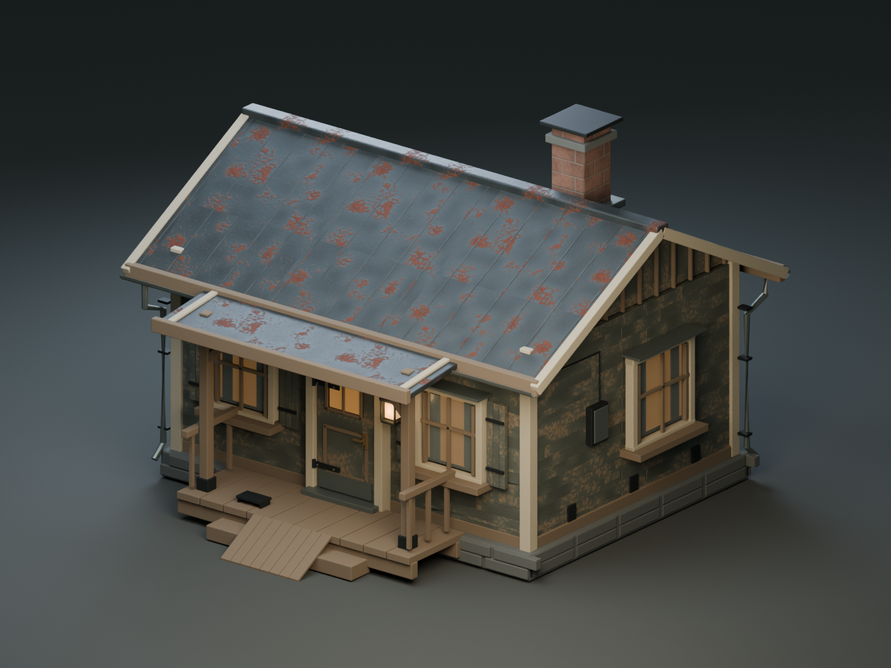
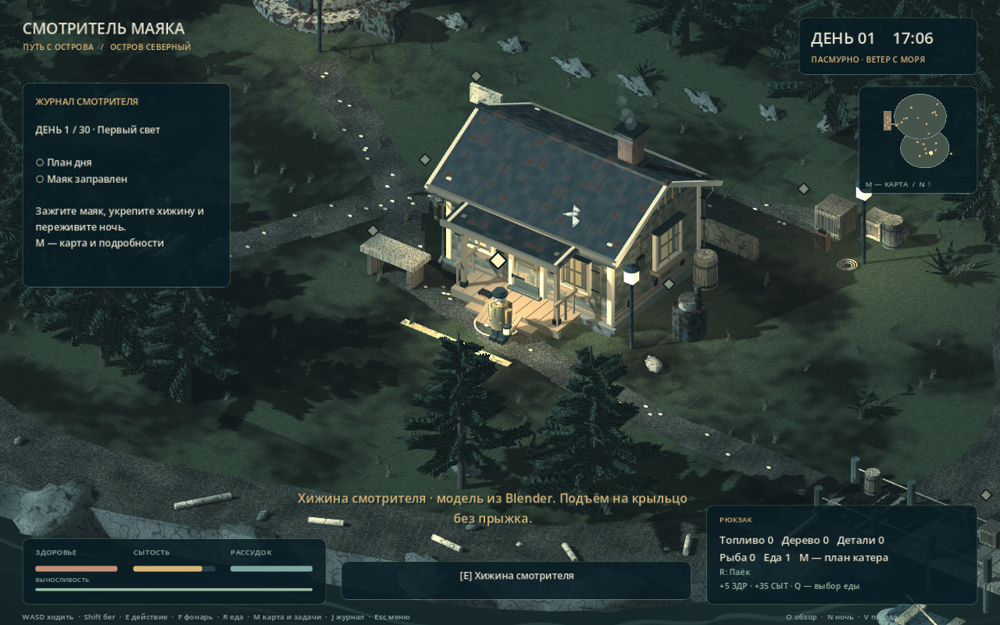
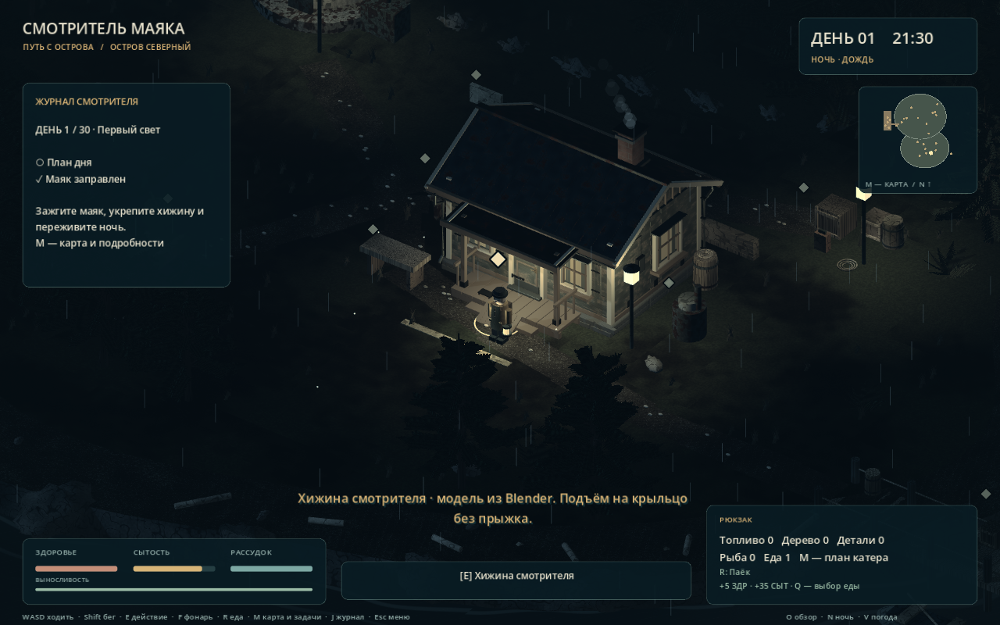

# A04 · Хижина смотрителя

Внешняя модель сделана **в Blender 5.2.2 LTS через MCP for Blender 2.2.4** и установлена в рабочую сцену Godot. Все операции с геометрией, материалами, UV, экспортом и рендером выполнялись через настоящий MCP stdio-сервер и аддон Blender. Godot отвечает за свет, дым, физику и игровой код.

## Файлы

- [Редактируемый исходник .blend](../../../assets/source_blender/keeper_cabin/A04_keeper_cabin_v01.blend).
- [Автономный GLB](../../../assets/models/keeper_cabin/keeper_cabin_v01.glb).
- [Статистика модели](asset-statistics.json), [проверка GLB](glb-inspection.json), [повторное открытие исходника](source-roundtrip.json), [сеанс MCP](mcp-session.json).
- [Результаты проверок](verification-summary.json) и [локальный замер Godot](godot-profile.json).
- Скрипты изготовления: tools/blender/cabin_01_structure.py — cabin_07_material_review.py. Пути PROJECT в скриптах нужно изменить для повторного изготовления на другом компьютере. Для обычного редактирования достаточно открыть .blend.

## Что входит

Обветренная горизонтальная обшивка с отдельными досками, глухая основа стен, каменное основание, наклонная фальцевая крыша с объёмными швами, конёк, фронтоны, наличники, водостоки и крепления. Есть окна с рамами, откосами, подоконниками, стеклом и простыми занавесками за ним. Дверь имеет накладные петли, ручку, нижнюю защиту и отдельный шарнир для будущей анимации.

Крыльцо собрано из досок, опор, подкосов и боковых ограждений. К нему ведёт небольшой деревянный сход. Добавлены дымоход с колпаком, входной фонарь, электрический ящик, кабель, несколько скоб и номер дома.

**Это внешний вариант здания.** Посещаемого интерьера пока нет: дверь закрыта, а ночлег выполняется клавишей E у входа. Печь, верстак, укрепление и радио рядом сохранены из существующей игры и пока используют свои прежние модели.

## Детализация и материалы

Текущая версия: **51 638 треугольников**, 27 038 вершин, 7 экспортных частей, 40 поверхностей материалов и 14 материалов. В редактируемом источнике 499 объектов, которые объединяются для игрового экспорта.

Три общих семейства PBR-карт: дерево и краска — 1024 × 1024; кровельный металл — 1024 × 1024; кирпич дымохода — 512 × 512. Для каждого семейства есть base color, normal и ORM. Всего девять карт. Нижние и закрытые поверхности, основание, простой крепёж и тёмные полости используют постоянные материалы; плотного внутреннего оборудования и невидимых деталей нет.

Видимая форма крыши, досок, окон и крыльца имеет приоритет перед увеличением разрешения карт. Цветовые константы Principled переведены из sRGB в линейное пространство перед экспортом, чтобы отделка не выглядела белой в Godot. Все карты упакованы в .blend и GLB; для открытия модели дополнительные изображения и шрифты не нужны. В папке исходника также оставлены PNG для удобства правки материалов.

## Совместимость с Godot

- GLB в метрах: Blender Z вверх / вход по −Y → Godot Y вверх / вход по +Z.
- Корень здания находится в World/IslandGeometry/KeeperCabin, позиция (5, 1, 0), единичный масштаб.
- Геометрия импортируется как обычные MeshInstance3D и StandardMaterial3D; Blender для запуска игры не требуется.
- Семь частей: KC_Structure, KC_Roof, KC_Porch, KC_Windows, KC_Door, KC_Chimney и KC_Details. Источник сохраняет раздельные редактируемые детали.
- Дверь экспортирована с шарниром в Godot (−0.49, 0, 2.23); анимация открытия пока не подключена.
- Автоматические LOD и shadow meshes включены. tools/import_ship.gd — общий обработчик PBR для обеих моделей — создаёт mipmaps и включает анизотропную фильтрацию. Геометрию он не создаёт.
- Сохранены прежние простые коллизии стен, основания и крыльца. Для схода добавлена одна выпуклая форма, без коллизий на каждый гвоздь или доску.
- scripts/cabin_visual.gd подключает модель без изменения игровых станций; tools/install_cabin_visual.gd сохраняет её в world.tscn. Генератор build_world.gd тоже подключает модель после стилизации прототипа.

## Проверка в игре

tests/cabin_asset_test.gd содержит **24 проверки**: импорт, размер, оси, шарнир двери, UV, PBR, нормали, mipmaps, бюджет геометрии/текстур, наличие в игровой сцене, физический подъём и спуск по двум полосам крыльца, строительство укрепления, готовка, радио, ночлег и сохранение/загрузка.

Полный комплект проекта после установки хижины: **226 проверок**. Автоматические сценарии используют отдельные user://automated_* файлы и не перезаписывают сохранение игрока.

Локальный замер при полном запуске игры у хижины: около **60 FPS** на Intel Arc Graphics, Compatibility / OpenGL 3.3, окно 1280 × 800. Это результат одного ракурса на данном компьютере; данные кадра сохранены в godot-profile.json.

Для просмотра в игре достаточно начать обычную смену: герой появляется рядом с хижиной. Отдельный воспроизводимый просмотр и снимки: Godot --path <папка проекта> --script res://tools/preview_cabin.gd; параметр -- --stay оставляет окно для осмотра.
