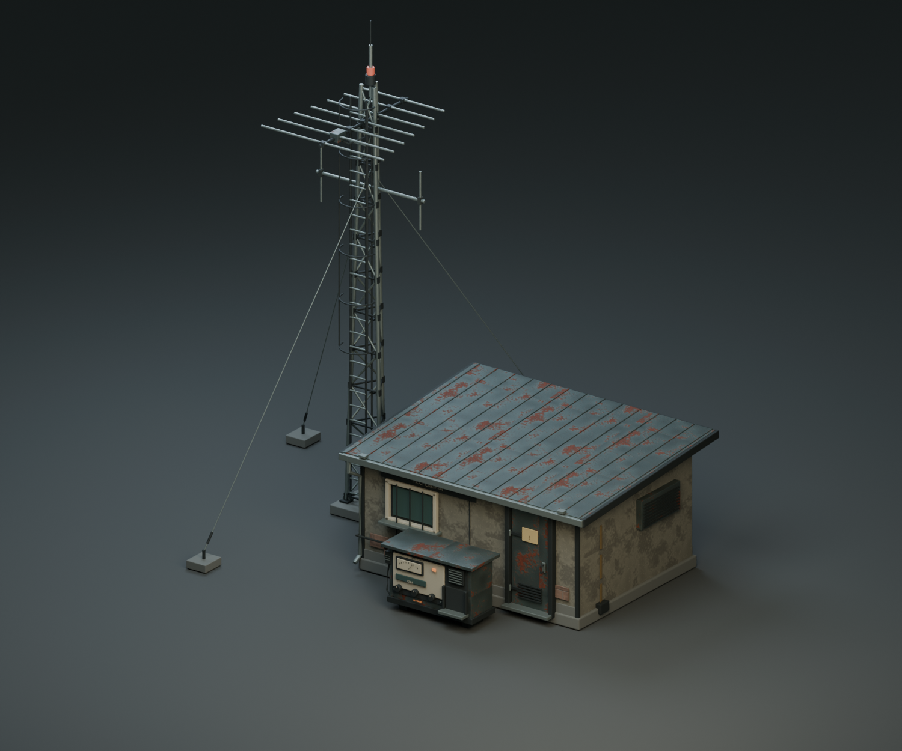
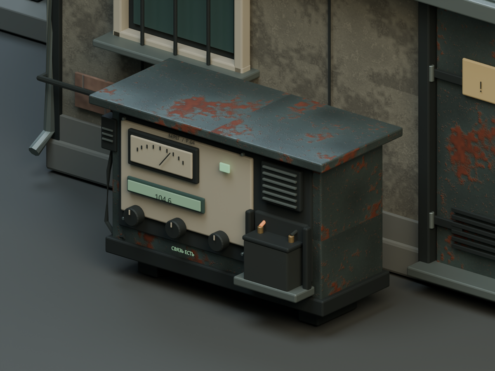
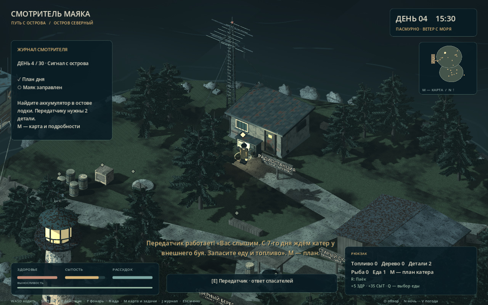

# A26–A28 · Радиостанция и антенна

Техническая будка, антенная мачта и наружный передатчик смоделированы **в Blender 5.2.2 LTS через MCP for Blender 2.2.4**. Геометрия, UV, материалы, экспорт и рендеры созданы через настоящий MCP stdio-сервер и аддон Blender. Модель установлена в Godot на прежнее место радиостанции.

## Файлы

- [Редактируемый .blend](../../../assets/source_blender/radio_station/A26_radio_station_v01.blend).
- [Автономный GLB для Godot](../../../assets/models/radio_station/radio_station_v01.glb).
- [Статистика](asset-statistics.json), [проверка GLB](glb-inspection.json), [повторное открытие .blend](source-roundtrip.json), [вызовы MCP](mcp-session.json).
- [Проверки игры](verification-summary.json), [локальный замер кадра](godot-profile.json).

## Что сделано

Будка имеет обветренную штукатурку, участки кирпича, металлическую крышу с фальцами, закрытую служебную дверь, окно с решёткой, вентиляцию, водосток и кабельные вводы. Посещаемого интерьера в этой версии нет; все игровые работы выполняются у наружного передатчика.

Мачта — сужающаяся треугольная ферма с раскосами, основанием, лестницей и защитными дугами. Наверху расположены направленная антенна, приёмные диполи, штырь и сигнальный огонь. Три растяжки имеют бетонные анкеры и натяжители. Кабель соединяет мачту с будкой и передатчиком.

Передатчик включает корпус с дождевым козырьком, стрелочную шкалу, частоту 104.6, ручки настройки, микрофон, динамик и батарейный отсек. До ремонта горит предупреждение «НЕТ СВЯЗИ», отсек пуст. После ремонта появляется аккумулятор, подсветка шкалы и надпись «СВЯЗЬ ЕСТЬ» с зелёным индикатором.

## Оптимизация

**42 444 треугольника**, 26 352 вершины, 9 экспортных частей и 43 поверхности материалов. Редактируемый источник содержит 340 объектов. Штукатурка и сталь используют общие PBR-карты 1024 × 1024, кирпич — 512 × 512; всего девять изображений. Простые и закрытые детали используют постоянные материалы. Внутреннее оборудование будки и скрытые поверхности не имеют отдельных дорогих карт.

Все изображения упакованы в .blend и GLB. Надписи преобразованы в меши, поэтому дополнительные шрифты для открытия и запуска модели не нужны. PNG в папке исходника оставлены для удобства редактирования.

## Godot и ремонт

- Модель в метрах, Blender Z вверх / вход −Y → Godot Y вверх / вход +Z.
- Корень установлен в World/NorthernCoast/RadioOutpost, позиция (−12, 1, −39.5), масштаб 1.
- Игровой импорт использует обычные MeshInstance3D и StandardMaterial3D, автоматические LOD, shadow meshes, mipmaps и анизотропную фильтрацию. Общий обработчик tools/import_ship.gd готовит текстуры, но не создаёт геометрию.
- Сохранены исходные физические тела будки, консоли и старой мачты. Новые простые формы защищают основание фермы и выступающую полку передатчика. Провода и растяжки не становятся невидимыми препятствиями.
- scripts/radio_visual.gd подключает модель и переключает RS_PanelFault, RS_PanelOnline и RS_BatteryInstalled. expedition.gd передаёт существующий state.signal после ремонта, загрузки и начала новой игры.
- Ремонт доступен с четвёртого дня: нужны инструменты, аккумулятор из остова лодки и две детали. Сохранились существующие требования, расход ресурсов и ответ спасателей.
- tools/install_radio_visual.gd сохраняет экземпляр в northern_coast.tscn; build_expansion.gd также подключает модель после подготовки прототипа.

## Проверка

[До ремонта](godot-before-repair.png) · [Ночной вид](godot-night.png).

tests/radio_asset_test.gd содержит **28 проверок** импорта, материалов, UV, нормалей, масштабов, бюджета, состояния ремонта, сохранения и физического обхода станции. Персонаж подходит к передатчику обычной ходьбой и обходит будку, включая проход между мачтой и западной стеной. Весь комплект проекта — **254 проверки**.

При обычном запуске Godot также выполнен ремонт через существующий обработчик взаимодействия; после него включились новые визуальные части и осталось две детали из четырёх. Дневной, ночной и оба ремонтных вида сохранены реальным запуском игры.

Один локальный замер у радиостанции: около 60 FPS на Intel Arc Graphics, Compatibility/OpenGL 3.3, окно 1280 × 800. Это результат данного ракурса на этом компьютере; полный отчёт лежит в godot-profile.json.

## Редактирование и просмотр

Исходник открыт в Blender. В коллекции RS_SOURCE_EDITABLE находятся отдельные детали; RS_GAME_EXPORT содержит объединённые части для игры, RS_PRESENTATION_NOT_EXPORTED — только студийный свет, камеру и землю. Готовую модель можно редактировать без MCP и без запуска скриптов изготовления.

Авторские скрипты находятся в tools/blender/radio_*.py. Они выполняются через MCP и используют общие функции из cabin_01_structure.py, загружая только определения функций. Порядок изготовления: 01 → 02 → 03; правка дисплея 05 → повторный 03; затем 04 для рендеров и 06 для проверки исходника. Перед повторным изготовлением на другом компьютере нужно изменить PROJECT и работать в отдельной сцене Blender.

Обычная игра: радиостанция находится на северо-западе острова и отмечена на карте M. В демонстрации гавани пятого дня она уже отремонтирована. Отдельный просмотр четвёртого дня: Godot --path <папка проекта> --script res://tools/preview_radio.gd -- --stay; передатчик можно починить клавишей E. Просмотр не перезаписывает сохранение игрока.
