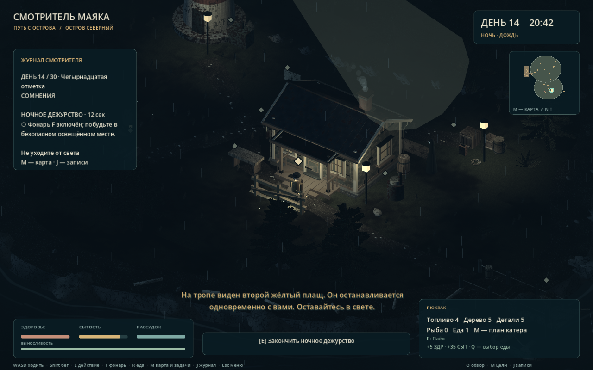
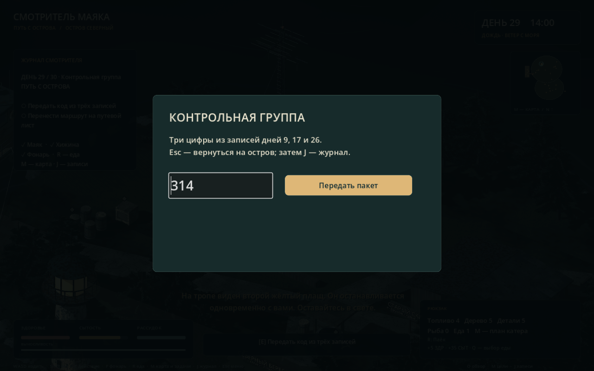

# Кампания «Тридцать дежурств»

**Реализовано в игре:** 30 разных дней, короткая подготовка, 29 ночных сцен, журнал находок, код связи и отплытие утром 30-го дня. [Все дни и сюжетные тексты](ALL_30_DAYS.md) выгружены из игрового campaign_days.gd; это действующий контент, а не список будущих идей.

## Ритм и прохождение

Обычно игрок выполняет одну-две задачи, включает маяк, проверяет укрепление, сытость и ручной фонарь. Бирюзовая отметка на карте M указывает следующий объект. Встреченные записи доступны в J.

Дневной таймер ориентирован на 50 секунд. Если задача или подготовка не закончена, игра остаётся в сумерках и не наказывает внезапной сменой дня. Когда всё готово, E у двери хижины сразу приближает ночь. Ночью нужно выполнить указание и выдержать сцену, затем снова нажать E у входа.

Минимальная ночная сцена длится 10–20 секунд. Это дежурство, а не жёсткий срок: при отключении света ночь дождётся восстановления питания. Месяц не обрывается из-за одной задержки. Карта, чтение, меню, рыбалка и окно кода останавливают игровое время.

Номинальная сумма 29 дневных таймеров и ночных сцен — **1897 секунд, или 31 минута 37 секунд**, плюс финальные действия и отплытие. Ранний закат может сократить ожидание; исследование, чтение и дополнительные занятия увеличат время. Ориентир короткого прохождения — около 30–40 минут, но человеческий плейтест для точной длительности ещё нужен.

## История

| Дни | Глава | Что меняется |
| --- | --- | --- |
| 1–7 | Обустройство | Маяк, убежище, инструменты, вода, связь, корпус и двигатель. Шторм закроет море до конца месяца |
| 8–15 | Сомнения | Свои следы и почерк, прежние ремонты, первый фрагмент кода и фигура в таком же плаще |
| 16–23 | Память | Резервный огонь, второй фрагмент, записи о бессоннице и проверка настоящего позывного |
| 24–30 | Путь с острова | Последний шторм, запасы, третья цифра, ввод контрольной группы, последнее дежурство и выход |

Смотритель постепенно узнаёт собственные следы в том, что считал чужим присутствием. При этом игра не объявляет однозначного объяснения всему происходящему. Для выхода он учится сверять приборы, время и записи, вместо того чтобы идти за голосом в темноту.

## Ночные действия

- **Шаги и стук:** переждать сцену в безопасном свете, держать фонарь включённым.
- **Наблюдатель:** неподвижная неатакующая фигура у деревьев; приближаться не требуется.
- **Двойник:** используется внешность смотрителя; он движется, когда движется игрок, и останавливается вместе с ним. Он не наносит урон.
- **Ложный вызов и помехи:** подойти к домашнему радио у западной стены хижины и нажать E.
- **Отключение маяка:** ручной фонарь остаётся рабочим. E у генератора восстанавливает питание без повторного расхода канистры.
- **Шторм:** дождь усиливается; нужно удержаться у света. Костёр в гавани тоже создаёт безопасную область.
- **Тишина:** море, дождь и фоновый гул приглушаются, появляются редкие пространственные звуки.
- **Осада света:** несколько активных теней подходят к убежищу; укрепление, маяк и фонарь продолжают защищать.
- **Ночь 29:** сначала питание у маяка, затем подтверждение на домашнем радио, потом дверь хижины.

Первые три ночи вводят угрозу без атак сюжетных фигур. Дальше появляются активные тени. Реплики передаются текстом и синтезированными звуковыми сигналами; записанной актёрской озвучки нет.

## Еда, топливо и ресурсы

Генератор хранит запас на три ночи с одной канистры; утром нужно снова включить его. Зажжённый маяк повторно топливо не списывает. Бочка по-прежнему выдаёт две канистры в день, склад — две детали, валежник возобновляется.

Часть сюжетных находок даёт реальные дрова, детали, пайки, рыбу и резервное топливо. На 11-й день улов из брошенной ловушки нужно действительно приготовить на печи. Рыбалка, редкость и вес рыбы, ловушка и приготовление пищи остаются полноценными дополнительными занятиями.

Ночлег расходует 8 сытости и восстанавливает 5 здоровья. Для начала ночи нужны укрепление, включённый маяк, фонарь и минимум 12 сытости. Три блюда для катера хранятся отдельно после погрузки и повторно не расходуются.

## Код и финал — спойлеры

В днях 9, 17 и 26 находятся цифры **3, 1 и 4**. После первой находки J открывает отдельную страницу контрольной группы; неполученные цифры показаны вопросами. Остальные записи листаются стрелками.

На 29-й день взаимодействие с передатчиком открывает поле ввода. Неверный ответ не тратит ресурсы и не засчитывает задачу. Esc закрывает окно, Enter или кнопка передают код. После подтверждения нужно перенести маршрут на путевой лист катера и пройти последнюю ночь.

Утром 30-го дня к штурвалу допускает весь набор: 29 оконченных ночей, разрешение на выход, сигнал, корпус, двигатель, топливо и три готовых блюда. Даже полностью починенный раньше катер не пропускает сюжетную кампанию. Последний день не превращается в автоматический проигрыш из-за перехода к дню 31.

## Сохранения и повторение дня

F9/F10 используют прежний ручной слот first_shift_save.json. Начало нового дня сохраняется отдельно в campaign_day_checkpoint.json. После смерти кнопка предлагает повторить день. Ручной слот также несёт свою контрольную точку, поэтому загрузка середины кампании не возвращает игрока к старому первому дню.

Формат 4 сохраняет цели, записи, ночной таймер, ожидаемое действие, заряд генератора и фонарь. Старые форматы 1–3 сохраняют ресурсы и ремонты; уже пройденные дни засчитываются, необходимые прошлые части кода добавляются в архив. Импортированная ночь запускает соответствующее новое событие с начала.

В последний день склад и гавань позволяют добрать недостающий минимум для незаконченных ремонтов и пустого бака. Старое сохранение не застрянет из-за того, что для получения следующих двух деталей пришлось бы ждать 31-й день.

## Файлы и проверка

- scripts/campaign_days.gd — 30 дежурств и их тексты; [машинная выгрузка](days.json).
- scripts/campaign.gd — цели, подготовка, ночные события, код, журнал и сохранение состояния.
- scripts/main.gd, expedition.gd, hud.gd, island_map.gd — включение кампании в существующую игру.
- shadow.gd — пассивные фигуры, наблюдатель и зеркальное движение двойника; soundscape.gd — пространственные сигналы и тишина.
- tests/campaign_test.gd — 208 проверок. Прогон проходит месяц через настоящие обработчики станций, без добавления запасов вручную. Перемещения между станциями в этом сценарии автоматизированы постановкой персонажа; физические проходы проверяются отдельными наборами.
- Общий набор проекта — 462 проверки. [Итог проверки](verification.json).
- tools/preview_campaign.gd — отдельные снимки подготовки, карты, ночи, журнала и кода. Демонстрация не пишет в сохранение игрока.

[Подготовка](day-preparation.png) · [Карта и план](map-and-plan.png) · [Журнал контрольной группы](journal-code.png).

«Свободный осмотр · гавань» остаётся отдельной демонстрацией прототипа и моделей. В нём сохранена прежняя короткая экономика ремонта; новая сюжетная игра запускается через «Начать смену».
