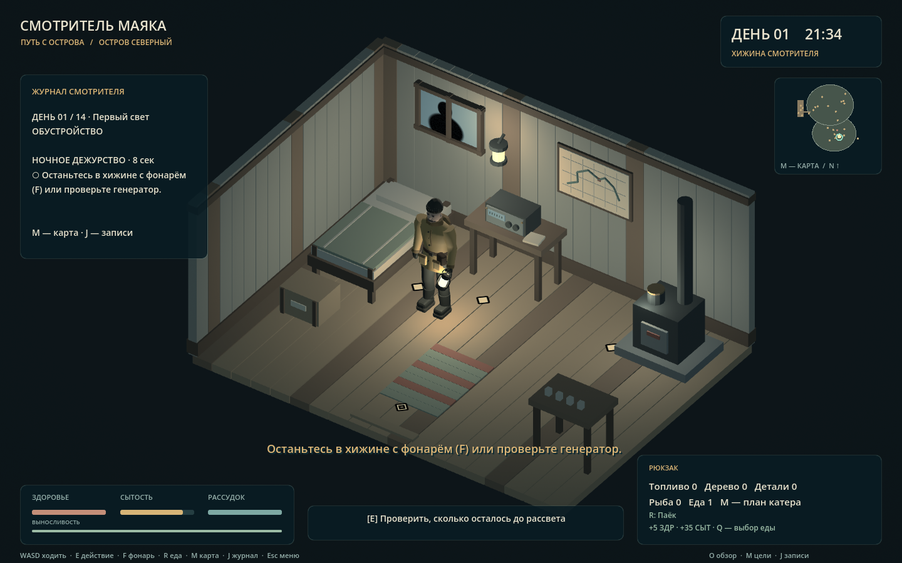

# Смотритель маяка · Кампания на 14 дней

Новая игра состоит из 14 дней и 13 ночей. [Полный план](ALL_14_DAYS.md) выгружен из игрового сценария. Старые сохранения продолжают [исходную кампанию](ALL_30_DAYS.md) с прежними датами задач, улик и выхода.

## Как сократили кампанию

| Дни | Глава | Что происходит |
| --- | --- | --- |
| 1–4 | Обустройство | Запуск маяка, первая ночь, инструменты со склада, ремонт насоса и выход на связь с материком |
| 5–8 | Сомнения | Первая цифра, ремонт корпуса и двигателя, собственные следы на тропе, вторая цифра и отключение света |
| 9–12 | Память | Готовка, запасной огонь, записка о бессоннице, третья цифра, проверка курса в рубке и погрузка провизии |
| 13–14 | Путь с острова | Ввод кода, последнее дежурство с отключением маяка и проверкой радиосигнала, отплытие к внешнему бую |

Ремонт катера и поиск улик идут параллельно. Повторные проверки насоса, контактов и корпуса убраны из обязательного маршрута. Часть находок даёт детали, дерево, еду и топливо. Рыбалка, вода, аптечка и ловушка доступны между заданиями.

Сумма дневных таймеров и ночных сцен составляет **14:07**. Когда задачи и подготовка готовы, можно приблизить ночь клавишей **E** у хижины. Ночные сцены длятся от 12 до 20 секунд. Время сверх таймера зависит от действий игрока, исследования и чтения.

## Первая смена

1. Найдите канистру и запустите генератор. Зайдите в маяк, поднимитесь по лестнице и нажмите **E** у работающей линзы.
2. Соберите три дерева, укрепите хижину у верстака и начните дежурство у койки.
3. В радио появятся помехи, а в окне — силуэт. Переждите шаги с включённым фонарём или проверьте генератор снаружи.
4. Встретьте рассвет у койки. Журнал **J** запишет ваш выбор и направит к красному ящику на старом складе.

## Демо для защиты

В главном меню выберите **«Демо · Первая смена»**. После вступления выполните задачи первого дня и переживите ночь. На рассвете **J** откроет памятку с позывным береговой станции. Подойдите к домашнему радио и нажмите **E**. Ответ можно выбрать мышью или клавишами **1** и **2**. Подтверждение связи завершает эпизод и возвращает к главному меню через итоговый экран.

Эпизод задуман для показа на 5–10 минут. Время прохождения зависит от знакомства с островом и управления. Две реплики диспетчера озвучены синтезированным русским голосом и сопровождаются субтитрами. Повторное открытие диалога воспроизводит входящую реплику с начала. Файлы кампании защищены от записи из демо.

[Вступление](demo-intro.png) · [Выбор ответа по радио](demo-radio.png) · [Экран завершения](demo-ending.png).

## Подготовка и ночные события

**M** показывает следующую цель, **J** — записи. Карта, журнал, меню, рыбалка и окно кода ставят игровое время на паузу.

Для начала ночи нужны укрепление, включённый маяк, ручной фонарь и минимум 12 сытости. Генератор расходует одну канистру на три ночи. После рассвета его нужно снова включить. Ночлег отнимает 8 сытости и восстанавливает 5 здоровья.

- Первые три ночи знакомят с угрозой через шум, стук и наблюдателя.
- При помехах и ложном вызове подойдите к домашнему радио. При отключении света верните питание на генераторе.
- Двойник повторяет движения смотрителя. Во время осады и шторма держитесь освещённого места.
- На 9-й день приготовьте найденную рыбу, на 12-й погрузите три готовых блюда.

## Код и отплытие

Три фрагмента кода находятся на **5-й**, **8-й** и **11-й** дни. Страница контрольной группы в журнале показывает найденные цифры. На **13-й день** откройте поле ввода у передатчика и передайте код. Затем перенесите курс на карту в рубке, восстановите питание во время последней ночи и подтвердите сигнал у домашнего радио.

Утром **14-го дня** проверьте бак и провизию. Для отплытия нужны работающий передатчик, исправные корпус и двигатель, три канистры топлива, три готовых блюда и разрешение после последней ночи. **E** у штурвала запускает переход к внешнему бую. Недостающие детали и топливо можно добрать на складе и в гавани в последний день.

## Сохранения и проверка

Сохранения указывают длину своего календаря. Партии, начатые до обновления, сохраняют свои дни, задания и записи журнала. Контрольная точка начала дня проверяет календарь перед загрузкой.

Автоматический прогон проходит обе версии через реальные игровые действия и добычу ресурсов. В этом тесте переходы между станциями автоматизированы. Отдельные тесты проверяют физические проходы, лестницу маяка, трап и интерьеры. [Результаты](verification.json) · [Данные 14 дней](days.json).

[Подготовка](day-preparation.png) · [Карта и план](map-and-plan.png) · [Двойник](night-event.png) · [Журнал](journal-code.png) · [Передатчик](radio-code.png).

«Свободный осмотр · гавань» — отдельная демонстрация. Кнопка «Начать смену» запускает новую кампанию на 14 дней.
